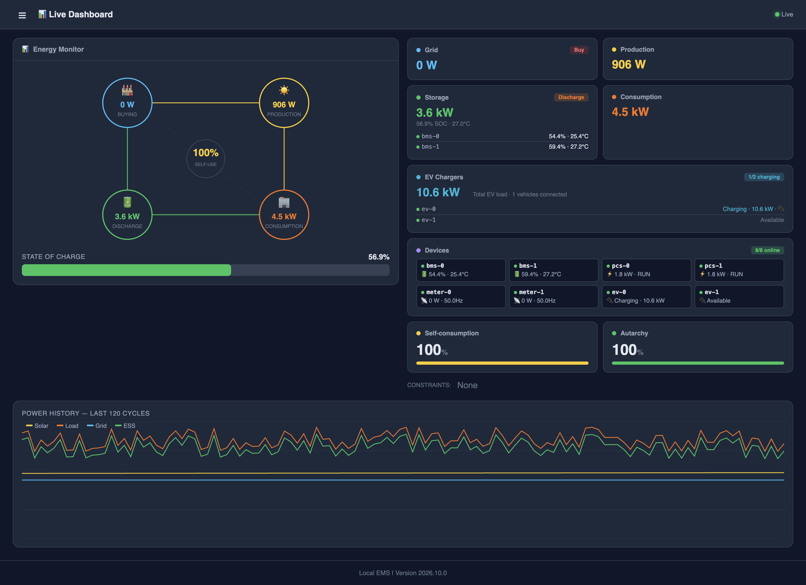
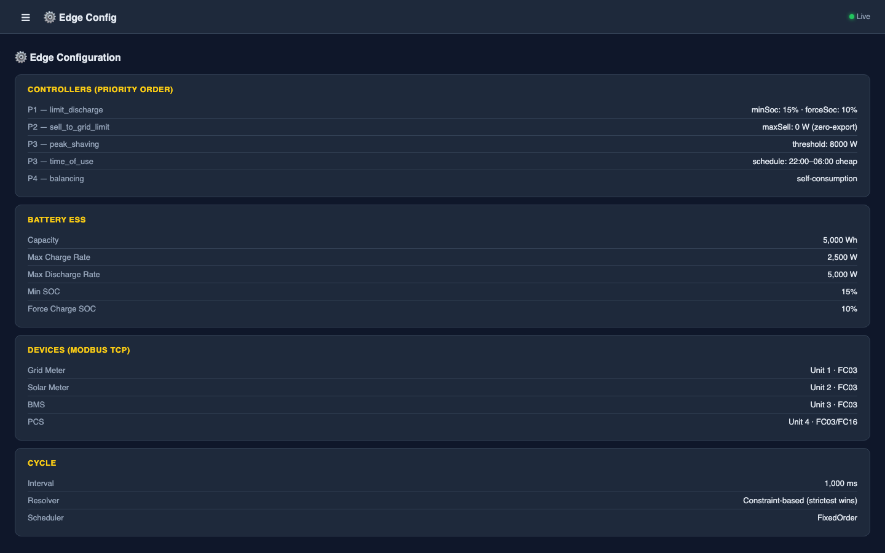
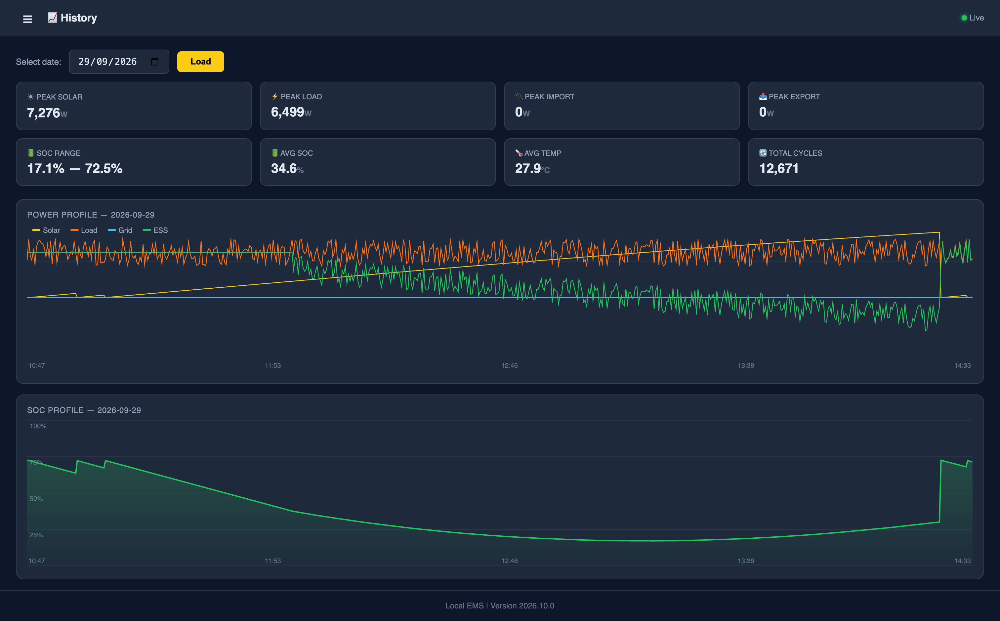

<p align="center">
  <h1 align="center">⚡ EMS Platform</h1>
  <p align="center">
    Energy Management System — On-Premise Controller + Cloud Fleet Management
  </p>
</p>

---

## Overview

Monorepo for the **CDI Energy Management System** platform. The system manages Battery Energy Storage Systems (BESS) at industrial sites, solar farms, and smart homes.

| Component | Description | Status |
|-----------|-------------|--------|
| [`ems-local/`](ems-local/) | On-premise Go controller — runs on-site, zero cloud dependency | ✅ Production |
| [`ems-cloud/`](#ems-cloud) | Cloud-based multi-tenant fleet management (NestJS + React) | 🔜 Phase B |
| [`contracts/`](contracts/) | Shared MQTT schemas for Local ↔ Cloud communication | ✅ Defined |
| [`docs/`](docs/) | Architecture, specs, plans, screenshots | ✅ Organized |

## Architecture

```
┌─────────────────────────────────────────────────────────┐
│                    ems-cloud (Phase B)                   │
│  NestJS API  ·  React Dashboard  ·  PostgreSQL/TimescaleDB│
│  Multi-tenant fleet management, analytics, remote control│
└──────────────────────┬──────────────────────────────────┘
                       │ MQTT (contracts/)
                       │ telemetry ↑  commands ↓
┌──────────────────────┴──────────────────────────────────┐
│                      ems-local                          │
│  Go binary  ·  Modbus TCP  ·  SQLite  ·  Constraint Chain│
│  Reads sensors, runs control logic, writes to hardware   │
│                                                         │
│  Devices: BMS · PCS · Meter · EV Charger (OCPP 1.6J)   │
│  Controllers: Peak Shaving · TOU · DLM · Grid Limit    │
└─────────────────────────────────────────────────────────┘
```

## Local EMS — Key Features

| Feature | Details |
|---------|---------|
| **Constraint-based Control** | 6 controllers with priority chain (P1 safety → P4 optimization) |
| **Multi-brand PCS** | Sungrow, Sinexcel, LiteOn, Generic — profile-based driver system |
| **BESS Topology** | Configurable groups with `master` / `individual` command modes |
| **EV Charging** | OCPP 1.6J + Dynamic Load Management |
| **Dashboard** | Embedded web UI with dark/light mode, EN/VN i18n |
| **Minimal Deps** | Only 2: `go-sqlite3` + `yaml.v3`. Single binary, cross-compile |
| **Cloud Sync** | MQTT store-and-forward telemetry (planned) |

## Quick Start

```bash
cd ems-local

# Prerequisites: Go 1.27+, GCC (for SQLite CGO)
# macOS: xcode-select --install
# Ubuntu: sudo apt install build-essential

# Run in simulation mode (no hardware needed)
make run

# Build for current OS
make build

# Run tests
make test
```

See [`ems-local/README.md`](ems-local/README.md) for full documentation.

## Screenshots

<p align="center">
  
</p>
<p align="center">
  
</p>
<p align="center">
  
</p>

## Project Structure

```
vmo_bid_cdi/
├── ems-local/           # Go on-premise controller (see ems-local/README.md)
│   ├── cmd/ems-core/    #   Entry point
│   ├── internal/        #   Business logic (engine, devices, modbus, ...)
│   ├── web/             #   Embedded HTML dashboard
│   ├── config/          #   YAML configs & PCS profiles
│   └── scripts/         #   Install/uninstall scripts
├── contracts/           # Shared MQTT message schemas (JSON Schema)
│   ├── telemetry.schema.json
│   └── commands.schema.json
├── docs/                # Documentation
│   ├── architecture/    #   System architecture diagrams
│   ├── specs/           #   Requirements & Q&A
│   ├── plans/           #   Design plans & roadmaps
│   └── screenshots/     #   UI screenshots
├── references/          # Reference code (not committed)
├── CLAUDE.md            # AI coding agent guidelines
└── Makefile             # Top-level orchestrator
```

## <a id="ems-cloud"></a>EMS Cloud (Coming Soon)

Multi-tenant cloud platform for fleet management:
- **API**: NestJS + TypeScript + PostgreSQL/TimescaleDB
- **Dashboard**: React + Recharts for analytics
- **Features**: Multi-site monitoring, remote control, alerting, reporting
- Communication via MQTT using schemas defined in [`contracts/`](contracts/)

## Documentation

| Document | Description |
|----------|-------------|
| [`ems-local/README.md`](ems-local/README.md) | Local EMS architecture, build, config, controller guide |
| [`contracts/README.md`](contracts/README.md) | MQTT topics, telemetry/command schemas |
| [`docs/plans/ems-mvp-plan.md`](docs/plans/ems-mvp-plan.md) | Detailed design & task roadmap |
| [`docs/plans/cloud-erp-plan.md`](docs/plans/cloud-erp-plan.md) | Cloud ERP plan (Phase B) |
| [`docs/plans/deployment-guide.md`](docs/plans/deployment-guide.md) | Smart Home & Factory deployment |

## Tech Stack

| Layer | Technology |
|-------|-----------|
| Local Controller | Go 1.27, Modbus TCP, SQLite (WAL), YAML |
| Cloud API (planned) | NestJS, TypeScript, PostgreSQL, TimescaleDB |
| Cloud UI (planned) | React, Recharts, Tailwind CSS |
| Communication | MQTT (store-and-forward) |
| Build | Make, Docker (cross-compile) |

## Contributing

1. Follow [Effective Go](https://go.dev/doc/effective_go) and `go vet` / `golint`
2. Controllers **only add constraints** — never write to hardware directly
3. Every new controller must have comprehensive unit tests
4. Run `cd ems-local && make test` before submitting
5. Commit messages: conventional commits (`feat:`, `fix:`, `refactor:`)

## License

[MIT License](LICENSE)

---

<p align="center">
  Built with ❤️ by <a href="https://github.com/ptit9x">Richard Do</a>
</p>
