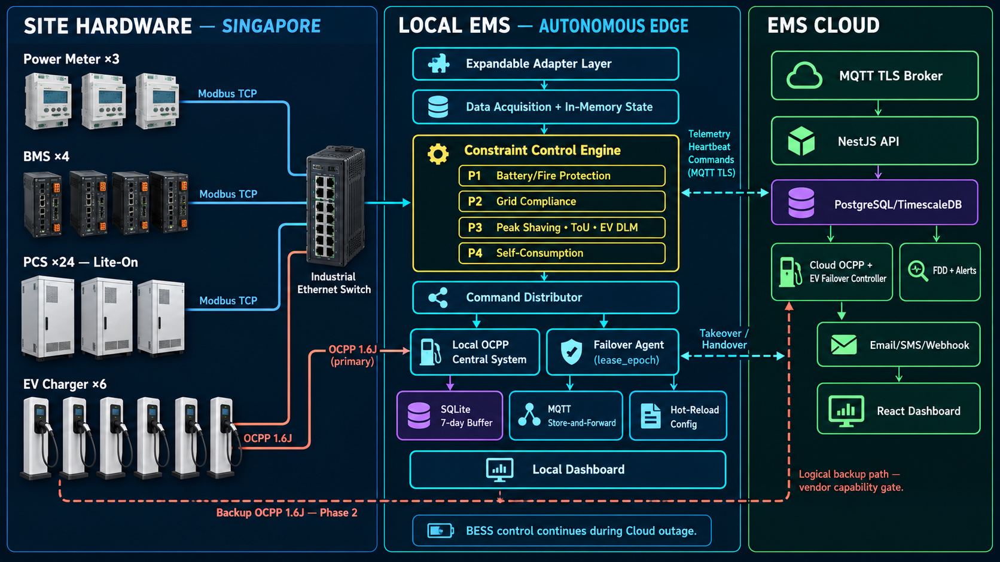
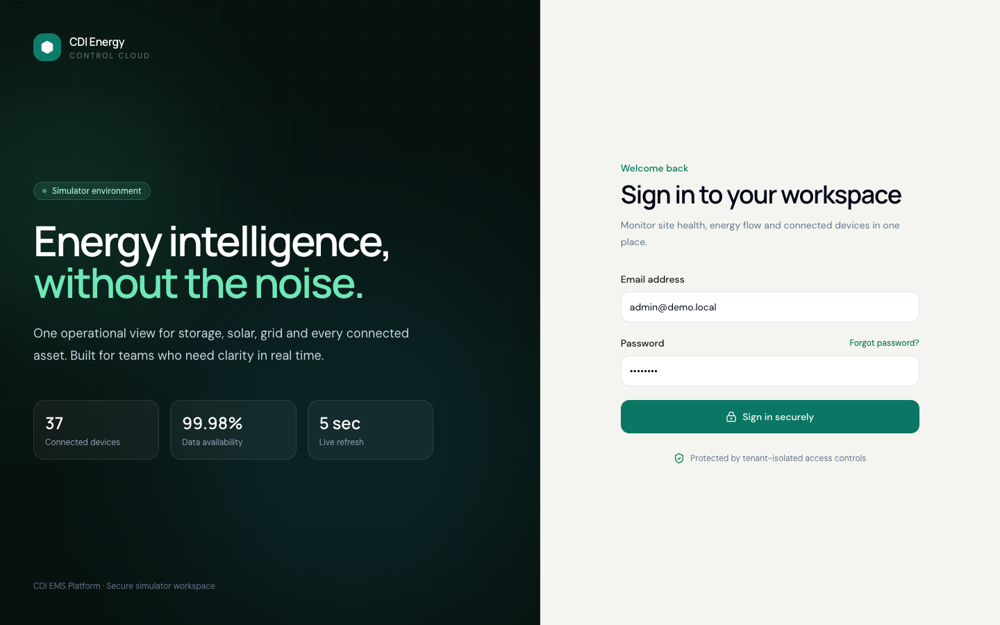
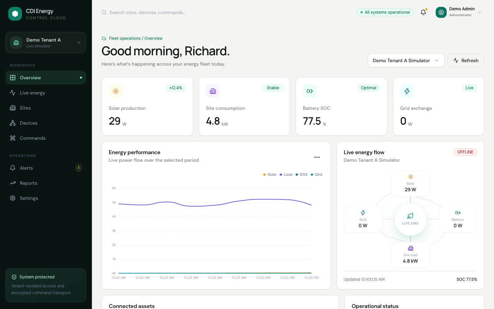
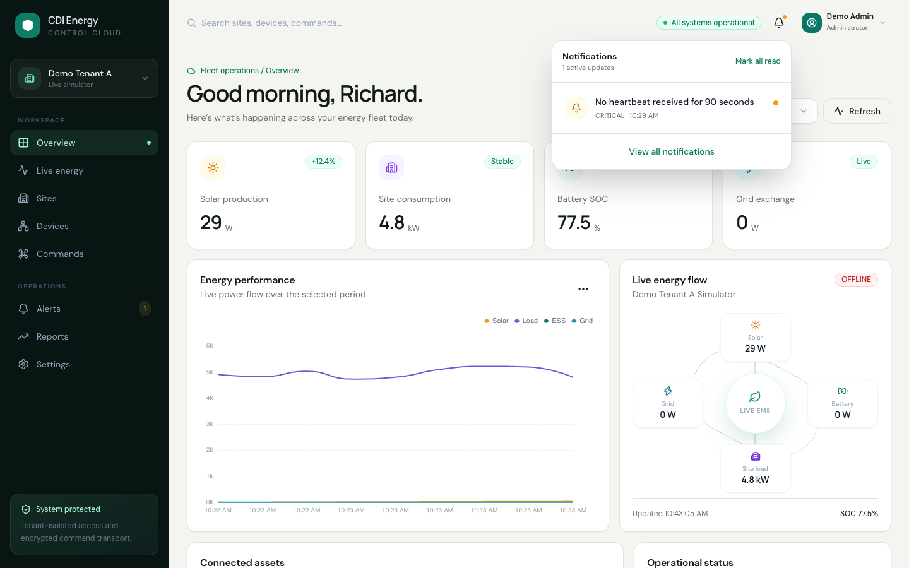
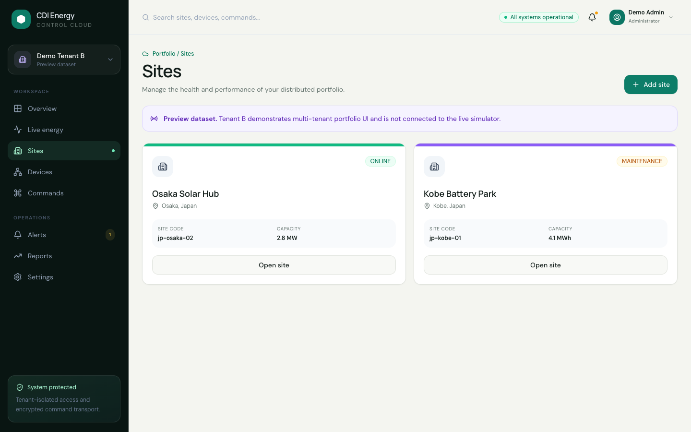
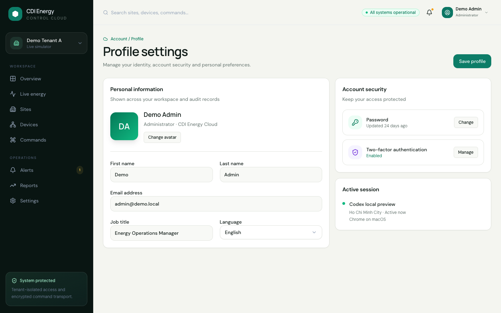
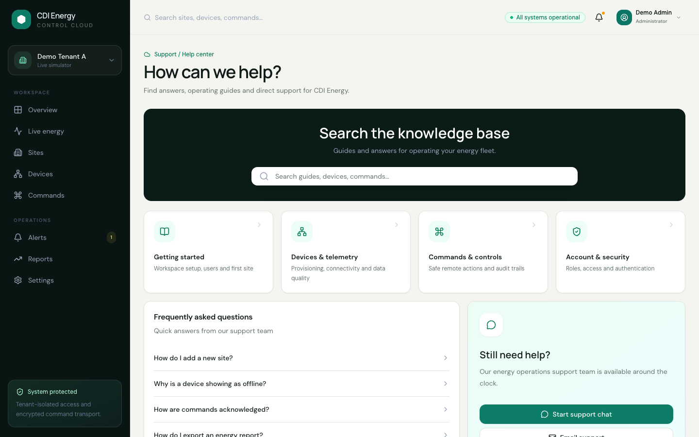

<p align="center">
  <h1 align="center">⚡ CDI EMS Platform</h1>
  <p align="center">On-site energy control, simulation, and cloud fleet monitoring</p>
</p>

---

## Overview

This monorepo contains the CDI Energy Management System (EMS): a Go service that runs at the site, a NestJS/React cloud platform, and the versioned MQTT contracts connecting them. The current end-to-end path is a simulator MVP; physical device integration still requires vendor register maps, calibration, and site acceptance testing.

| Component | What it contains | Current state |
|---|---|---|
| [`ems-local/`](ems-local/) | Go control engine, SQLite storage, embedded dashboard, hardware simulator, MQTT sync | Simulator MVP; hardware adapters are not commissioned |
| [`ems-cloud/`](ems-cloud/) | NestJS API, React dashboard, PostgreSQL/TimescaleDB, Mosquitto, tenant auth | Runnable simulator dashboard and API |
| [`contracts/`](contracts/) | JSON Schemas for telemetry and remote commands | Used by contract validation and Local ↔ Cloud messaging |
| [`docs/`](docs/) | Architecture, bid/specification inputs, implementation plans, screenshots, demo runbook | Supporting documentation |

## Architecture

<p align="center">
  <a href="docs/architecture/architecture_simple.png">
    
  </a>
</p>

Open the [full-size architecture diagram](docs/architecture/architecture.png) or view its [Mermaid source](docs/architecture/mermaid.mmd).

The detailed technical diagram is generated from Mermaid (`make architecture`).
The README overview is an icon-rich stakeholder infographic whose regeneration
specification is stored in `docs/architecture/architecture_simple.prompt.md`.
The technical view expands the Local adapter boundary into `AdapterFactory`,
`DeviceRegistry`, protocol/vendor selection, normalized snapshots and health. The
factory and registry-driven runtime polling/command orchestration are implemented.
Physical commissioning, vendor endpoint switching and site SAT remain external gates.
The dashed backup OCPP path is the Phase 2 logical design; physical endpoint
switching remains subject to EV charger vendor capability confirmation before SAT.

```text
┌──────────────────────────────────────────────────────────────┐
│ EMS Cloud                                                   │
│ React dashboard → NestJS API → PostgreSQL / TimescaleDB     │
│                         ↕ MQTT via Mosquitto                 │
└─────────────────────────┬────────────────────────────────────┘
                          │ telemetry ↑  commands/acks ↓↑
┌─────────────────────────┴────────────────────────────────────┐
│ Local EMS                                                    │
│ Go control loop → constraint resolver → PCS distribution     │
│ Modbus/OCPP abstractions · SQLite outbox · embedded web UI   │
│ BMS · PCS · grid/solar/load meters · EV chargers             │
└──────────────────────────────────────────────────────────────┘
```

The Local EMS continues operating and buffering telemetry in SQLite when Cloud or MQTT is unavailable. Once connectivity returns, queued telemetry is published with QoS 1 and deduplicated in Cloud by message ID.

## Quick Start: Full Simulator Demo

Requirements:

- Docker with Docker Compose
- Go 1.27+ and a C compiler (SQLite uses CGO)
- Ports `1883`, `3000`, `5173`, `5432`, `8080`, and `9001` available

```bash
git clone <repository-url>
cd vmo_bid_cdi
make demo
```

`make demo` builds and starts PostgreSQL/TimescaleDB, Mosquitto, the Cloud API and dashboard, then runs the Local EMS simulator with the CDI Singapore topology.

| Service | URL / connection | Credentials |
|---|---|---|
| Cloud dashboard | <http://localhost:5173> | `admin@demo.local` / `demo1234` |
| Cloud API | <http://localhost:3000/api> | Bearer token from `/api/auth/login` |
| Local dashboard | <http://localhost:8080> | `admin` / `ems@2025` |
| MQTT | `mqtt://localhost:1883` | Anonymous, development only |
| PostgreSQL | `localhost:5432/ems_cloud` | `ems` / `ems_secret` |

Health checks:

```bash
curl http://localhost:3000/api/health/live
curl http://localhost:3000/api/health/ready
```

Stop the demo while preserving data with `make demo-down`. `make demo-reset` removes the Docker volumes and the Local simulator database, so use it only when a clean reset is intended.

See the [simulator demo runbook](docs/plans/simulator-demo-runbook.md) for validation steps and known limitations.

## Run Components Separately

### Local EMS

```bash
cd ems-local
make run             # simulated development topology
make test
make build           # output: dist/ems-core
```

Useful runtime flags:

```text
--simulate           Enable simulated hardware
--config <path>      Load a YAML site configuration
--ui-port <port>     Override the dashboard port
--db <path>          Override the SQLite database path
--version            Print build version
```

The executable currently rejects non-simulation mode. Hardware-facing packages and PCS profiles exist, but production hardware operation is not enabled by the entry point yet.

### Cloud EMS

For the complete containerized stack, run `docker compose up -d --build` from `ems-cloud/`. For API development with infrastructure in Docker:

```bash
cd ems-cloud
cp .env.example .env
npm ci
docker compose up -d postgres mosquitto
npm run db:generate
npm run db:migrate
npm run dev
```

Start the Vite dashboard separately with `npm run dev:dashboard`. More details are in [`ems-cloud/README.md`](ems-cloud/README.md).

## Implemented Capabilities

### Local control and simulation

- One-second constraint-based control cycle with safety, grid compliance, peak shaving, time-of-use, EV load management, and balancing controllers.
- Configurable BESS groups and equal, proportional, or round-robin PCS setpoint distribution.
- Simulated BMS, PCS, meters, EV charging, solar/load curves, and a scripted acceptance scenario.
- SQLite WAL storage, retention, and store-and-forward telemetry outbox.
- Embedded authenticated dashboard with live WebSocket updates, history, health, configuration, and device views.
- MQTT telemetry publishing and allowlisted commands: `identify`, `update_tariff`, `update_config`, and `restart`.

### Cloud fleet management

- Tenant-scoped JWT authentication with refresh-cookie support and Admin/Operator/Viewer roles.
- Site, device, alert, telemetry history/latest/daily-summary, and remote-command APIs.
- MQTT telemetry ingestion, command acknowledgements, QoS 1 deduplication, and offline-site detection.
- Premium responsive React/Vite dashboard built with Tailwind, shared shadcn-style components, Radix UI and React Query. Includes authentication, tenant/site switching, fleet overview, live energy, sites, devices, commands, alerts, reports, settings, profile, help center and notifications.
- Seeded two-tenant simulator data for isolation checks.

The Cloud dashboard is complete as a simulator UI/MVP. Production provisioning, database RLS, alert email/webhook delivery and remote configuration writes remain tracked in [`docs/plans/implementation-status.md`](docs/plans/implementation-status.md).

### Cloud dashboard screenshots

| Login | Fleet overview |
|---|---|
|  |  |

| Notifications | Tenant B sites |
|---|---|
|  |  |

| Profile settings | Help center |
|---|---|
|  |  |

## MQTT Contract

The default topic prefix is `ems`.

| Topic | Direction | Purpose |
|---|---|---|
| `ems/{site_id}/telemetry` | Local → Cloud | Aggregated telemetry; demo interval is 10 seconds |
| `ems/{site_id}/heartbeat` | Local → Cloud | Site heartbeat |
| `ems/{site_id}/alerts` | Local → Cloud | Site alerts |
| `ems/{site_id}/command` | Cloud → Local | Allowlisted remote command |
| `ems/{site_id}/command/ack` | Local → Cloud | Command result acknowledgement |

Schemas and compatibility rules are documented in [`contracts/README.md`](contracts/README.md).

## Repository Layout

```text
vmo_bid_cdi/
├── ems-local/
│   ├── cmd/ems-core/          # executable entry point
│   ├── internal/              # engine, devices, storage, sync, simulator, UI
│   ├── config/                # site configs, scenario, PCS profiles
│   └── web/                   # embedded dashboard assets
├── ems-cloud/
│   ├── apps/api/              # NestJS API and Prisma schema
│   ├── apps/dashboard/        # React/Vite dashboard
│   ├── packages/shared/       # shared TypeScript contract types
│   └── docker/                # local infrastructure configuration
├── contracts/                 # JSON Schema contracts
├── docs/                      # architecture, specs, plans, screenshots
├── .github/workflows/ci.yml   # Go and Node CI
└── Makefile                   # top-level build/test/demo commands
```

## Common Commands

| Command | Purpose |
|---|---|
| `make build` | Build the Local EMS for the current platform |
| `make test` | Run Local EMS tests |
| `make test-contracts` | Validate sample payloads against JSON Schemas |
| `make test-cloud` | Generate Prisma client, build Cloud, and run API tests |
| `make test-all` | Run Local, contract, and Cloud checks |
| `make demo` | Start the full simulator demo |
| `make demo-down` | Stop demo containers and preserve data |
| `make demo-reset` | Delete all demo data |
| `make release` | Build Local smart-home and factory ZIP bundles |

## Configuration and Security

- Local configuration priority is environment variables, then the selected `.env` file, YAML, and defaults.
- Use [`ems-cloud/.env.example`](ems-cloud/.env.example) as the Cloud configuration template.
- All credentials shown above are simulator defaults. Change MQTT access, database credentials, dashboard credentials, and `JWT_SECRET` before any shared or production deployment.
- Do not expose the development Mosquitto or PostgreSQL ports to untrusted networks.

## Testing and CI

```bash
make test-all
```

CI runs Go tests with the race detector, `go vet`, the complete Cloud build, Jest, and JSON Schema contract validation. Because the Local EMS uses `go-sqlite3`, Go builds and tests require CGO and a working C compiler.

## Documentation

| Document | Purpose |
|---|---|
| [`ems-local/README.md`](ems-local/README.md) | Local architecture, control flow, build, and configuration |
| [`ems-cloud/README.md`](ems-cloud/README.md) | Cloud development and API details |
| [`contracts/README.md`](contracts/README.md) | MQTT topics, schemas, and change rules |
| [`docs/plans/simulator-demo-runbook.md`](docs/plans/simulator-demo-runbook.md) | Active end-to-end demo runbook |
| [`docs/plans/implementation-status.md`](docs/plans/implementation-status.md) | Current implemented/tested/production-readiness matrix |
| [`docs/plans/deployment-guide.md`](docs/plans/deployment-guide.md) | Deployment profiles and packaging notes |
| [`docs/specs/bid-analysis-report-v2.md`](docs/specs/bid-analysis-report-v2.md) | Bid requirements analysis |

Planning files under `docs/plans/` may describe future work; verify implemented behavior against the code and the simulator runbook.

## Contribution Notes

1. Controllers add constraints; they do not write to hardware directly.
2. Update `contracts/` first when changing Local ↔ Cloud payloads, then update both implementations in the same change.
3. Add tests for new control behavior and run `make test-all` before opening a pull request.
4. Use conventional commit prefixes such as `feat:`, `fix:`, `docs:`, and `refactor:`.
