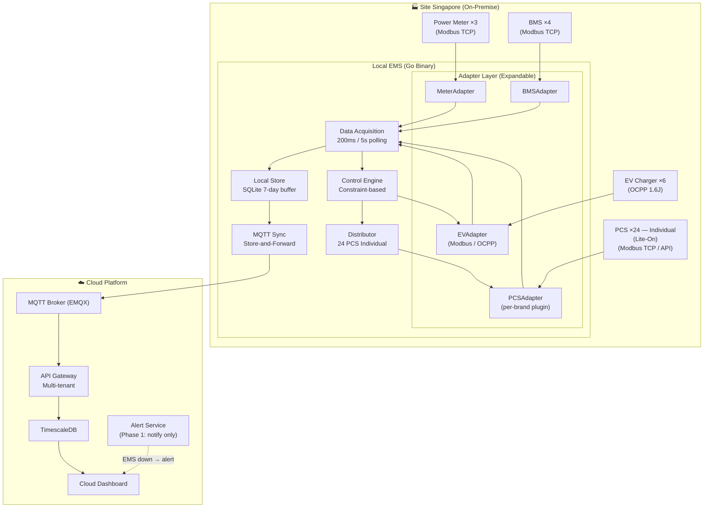
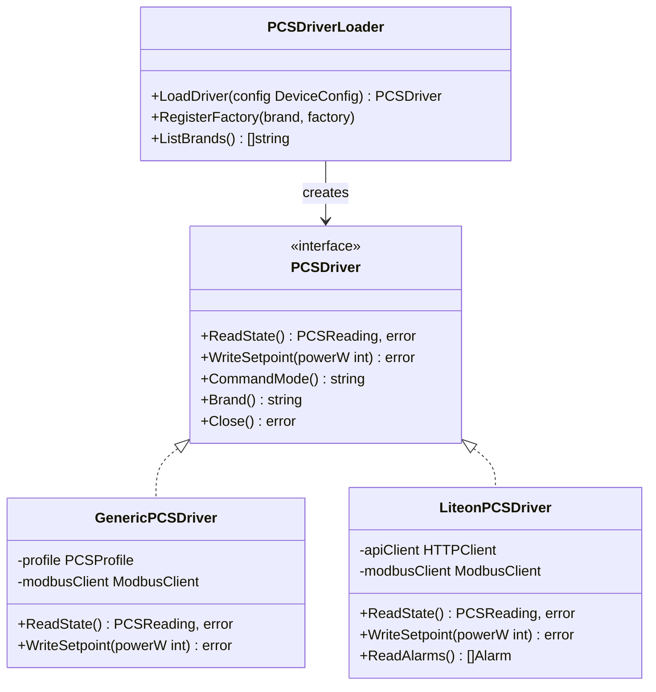
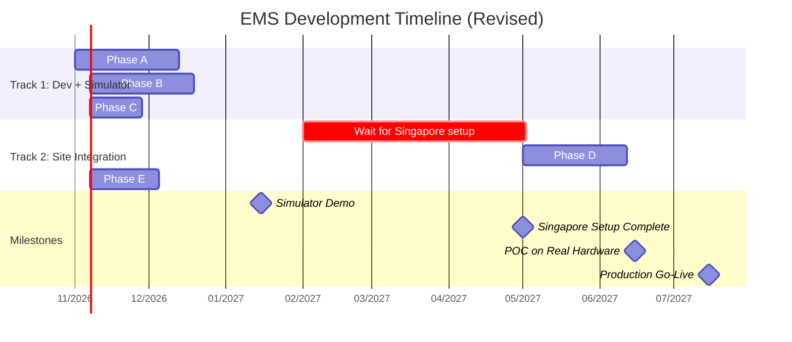

# 📐 Kế hoạch Thiết kế EMS — Cập nhật 14/10/2026

> **Baseline:** [task-plan-v2.md](file:///Users/richard/vmo_bid_cdi/docs/task-plan-v2.md) + [cdi-ems-proposal-v1.md](file:///Users/richard/vmo_bid_cdi/docs/cdi-ems-proposal-v1.md)
> **Trigger:** Phản hồi mới từ Ken (14/10/2026)
> **Codebase:** [internal/](file:///Users/richard/vmo_bid_cdi/internal/) — Go EMS engine

---

## Những gì thay đổi so với plan cũ

| # | Thay đổi | Plan cũ | Plan mới | Lý do |
|---|---|---|---|---|
| 1 | **Timeline** | Dev + POC liên tục | 2 track: Simulator → Site Integration | Setup Singapore ~5/2027 |
| 2 | **PCS command mode** | Master hoặc Individual | **Individual only** (Phase 1) | Ken xác nhận |
| 3 | **PCS brand** | Generic + Sungrow/Sinexcel | **Lite-On** ✅ (đã chốt) | Ken xác nhận |
| 4 | **Architecture** | Plugin PCS driver | **Expandable adapter** cho tất cả device types | Ken yêu cầu |
| 5 | **Cloud failover** | Full takeover EV | **Alert-only** (Phase 1) | VMO đề xuất giảm scope |
| 6 | **Site** | Giả định Đài Loan | **Singapore** | Ken xác nhận |

---

## 1. Kiến trúc tổng quan (cập nhật)



> [!IMPORTANT]
> **Thay đổi chính trong kiến trúc:**
> - Adapter Layer trở thành **layer riêng biệt**, expandable cho multi-vendor
> - PCS Distributor luôn ở mode **Individual** (gửi lệnh cho từng PCS)
> - Cloud failover Phase 1 chỉ là **Alert** (không takeover control)

---

## 2. Thiết kế PCS Adapter — Expandable Architecture

### 2.1 Kiến trúc hiện tại (đã có)

```
PCSDriver interface ← GenericPCSDriver ← YAML profile (register map)
```

- [pcs_driver.go](file:///Users/richard/vmo_bid_cdi/internal/devices/pcs_driver.go) — Interface: `ReadState()`, `WriteSetpoint()`, `CommandMode()`, `Brand()`
- [pcs_driver_generic.go](file:///Users/richard/vmo_bid_cdi/internal/devices/pcs_driver_generic.go) — Generic implementation dùng YAML register map
- [example.yaml](file:///Users/richard/vmo_bid_cdi/config/pcs_profiles/example.yaml) — Mẫu YAML profile

### 2.2 Cần mở rộng



### 2.3 Cách thêm brand mới (quy trình cho vendor tương lai)

```
Bước 1: Nhận Modbus register map / API doc từ vendor
Bước 2: Tạo YAML profile (nếu standard Modbus)
         HOẶC implement PCSDriver interface (nếu custom API)
Bước 3: Đăng ký vào PCSDriverLoader
Bước 4: Cập nhật config site → brand: "new_brand"
         Không cần sửa core engine code
```

> [!TIP]
> **Ken's requirement "expandable"** đã được đáp ứng bởi kiến trúc hiện tại. Chỉ cần:
> 1. Tạo file `config/pcs_profiles/liteon.yaml` khi có register map
> 2. Nếu Lite-On dùng API (không chỉ Modbus) → implement `LiteonPCSDriver` struct riêng

---

## 3. Thiết kế Individual PCS Control

### 3.1 Hiện tại
[distributor.go](file:///Users/richard/vmo_bid_cdi/internal/engine/distributor/distributor.go) đã hỗ trợ cả `master` và `individual` mode.

### 3.2 Cập nhật cho Phase 1

```
Ken yêu cầu: Individual mode — EMS giao tiếp trực tiếp 24 PCS

Control Flow:
┌─────────────────────────────────────────────────┐
│  Control Engine                                 │
│  Output: Total setpoint = 5000W                 │
└──────────────────┬──────────────────────────────┘
                   │
┌──────────────────▼──────────────────────────────┐
│  Distributor (Individual Mode)                  │
│  Algorithm: Equal / Round-robin / Priority      │
│                                                 │
│  PCS-01: 208W    PCS-09: 208W    PCS-17: 208W  │
│  PCS-02: 208W    PCS-10: 208W    PCS-18: 208W  │
│  PCS-03: 208W    PCS-11: 208W    PCS-19: 208W  │
│  PCS-04: 208W    PCS-12: 208W    PCS-20: 208W  │
│  PCS-05: 208W    PCS-13: 208W    PCS-21: 208W  │
│  PCS-06: 208W    PCS-14: 208W    PCS-22: 208W  │
│  PCS-07: 208W    PCS-15: 208W    PCS-23: 208W  │
│  PCS-08: 209W    PCS-16: 209W    PCS-24: 209W  │
└──────────────────┬──────────────────────────────┘
                   │ 24 concurrent Modbus writes
                   ▼
          ┌─────────────────┐
          │  Modbus Pool     │
          │  24 connections  │
          │  Timeout: 500ms  │
          └─────────────────┘
```

### 3.3 Lưu ý kỹ thuật

| Vấn đề | Giải pháp |
|---|---|
| 24 Modbus connections song song | [modbus/pool.go](file:///Users/richard/vmo_bid_cdi/internal/modbus/pool.go) — connection pool đã có |
| Cycle time 1s, 24 writes × ~50ms each | Goroutine concurrent write, `sync.WaitGroup` |
| 1 PCS offline → không ảnh hưởng 23 PCS còn lại | Graceful degradation (Task 10.4 trong plan) |
| Mixed brand (Lite-On + Wing cùng site) | `PCSDriverLoader` tạo driver đúng brand theo config |

---

## 4. Phases & Timeline (cập nhật)

### Tổng quan



---

### Phase A: Adapter Layer & Simulator Enhancement (6 tuần)

> **Mục tiêu:** Kiến trúc expandable hoàn chỉnh + Simulator cho 24 PCS individual

| # | Task | Mô tả | Effort | Depends | Status |
|---|---|---|---|---|---|
| A.1 | **Mở rộng PCSDriver interface** | Thêm `ReadAlarms()`, `Capabilities()`, `ProtocolType()` để hỗ trợ cả Modbus và API-based PCS | 2d | — | ✅ Done |
| A.2 | **Lite-On PCS adapter (stub)** | Implement `LiteonPCSDriver` với Modbus register map giả định. Swap sang real register map khi có documentation từ vendor | 3d | A.1 | ✅ Done |
| A.3 | **PCS Simulator 24-unit** | Mở rộng [simulator.go](file:///Users/richard/vmo_bid_cdi/internal/simulator/simulator.go) — 24 PCS individual mode (Lite-On profile), mỗi unit có state riêng (SOC, power, fault) | 3d | A.2 | ✅ Done |
| A.4 | **Distributor stress test** | Test concurrent write 24 PCS, measure cycle time, validate graceful degradation | 2d | A.3 | 🔜 Next |
| A.5 | **DeviceAdapter generalization** | Refactor [device.go](file:///Users/richard/vmo_bid_cdi/internal/devices/device.go) — thêm `DeviceAdapter` interface cấp cao hơn, support hot-swap protocol (Modbus ↔ API) | 3d | A.1 | ✅ Done |
| A.6 | **BMS/Meter adapter refactor** | Áp dụng pattern expandable cho BMS và Meter adapters | 2d | A.5 | ⬜ |
| A.7 | **EV Charger dual-mode** | Đảm bảo EV adapter chạy cả Modbus và OCPP mode ([evcharger_ocpp.go](file:///Users/richard/vmo_bid_cdi/internal/devices/evcharger_ocpp.go)) | 2d | A.5 | ⬜ |
| A.8 | **Config hot-reload** | Watch config file changes, device IP/brand thay đổi không cần restart | 3d | A.5 | ⬜ |
| A.9 | **Full simulator demo** | 4 BMS + 24 PCS (Lite-On) + 6 EV + 3 Meter chạy trên simulator, dashboard live | 2d | All above | ⬜ |

**Effort:** ~22 man-days (~10d done, ~12d remaining)

---

### Phase B: Cloud Platform MVP (6 tuần)

> **Mục tiêu:** Multi-tenant Cloud với monitoring + alert (KHÔNG failover control)

| # | Task | Mô tả | Effort | Depends |
|---|---|---|---|---|
| B.1 | **Docker Compose stack** | EMQX + PostgreSQL/TimescaleDB + Redis + NestJS | 2d | — |
| B.2 | **Database schema** | Tenants, sites, users, devices, telemetry (hypertable), alerts | 3d | B.1 |
| B.3 | **MQTT consumer** | Subscribe `ems/+/telemetry`, parse, insert TimescaleDB | 2d | B.1 |
| B.4 | **Auth + multi-tenant API** | JWT auth, tenant isolation, RBAC (Admin/Operator/Viewer) | 3d | B.2 |
| B.5 | **Site management API** | CRUD sites, provision new site (generate MQTT creds) | 3d | B.4 |
| B.6 | **Telemetry query API** | Time-series queries, aggregation (1min/5min/1h/1d) | 2d | B.3 |
| B.7 | **Alert engine** | Threshold rules, evaluate incoming data, send notification (email/webhook) | 3d | B.6 |
| B.8 | **EMS heartbeat monitor** | Monitor heartbeat, **gửi alert khi EMS offline** (không takeover) | 2d | B.7 |
| B.9 | **React dashboard — Fleet** | Site list, status cards, online/offline indicators | 3d | B.5, B.6 |
| B.10 | **React dashboard — Site detail** | Energy flow, historical charts, device list | 3d | B.9 |
| B.11 | **React dashboard — Alerts** | Active alerts, history, config rules | 2d | B.7, B.9 |
| B.12 | **i18n foundation** | English default, structure sẵn cho multi-language | 1d | B.9 |

**Effort:** ~29 man-days

---

### Phase C: Integration Testing trên Simulator (3 tuần)

| # | Task | Mô tả | Effort |
|---|---|---|---|
| C.1 | **End-to-end test** | Simulator → Engine → MQTT → Cloud → Dashboard | 3d |
| C.2 | **Load test** | 24 PCS × 200ms polling, validate cycle time < 1s | 2d |
| C.3 | **Failover scenario test** | Kill EMS → Cloud alert fires trong < 2 phút | 1d |
| C.4 | **Multi-tenant test** | 2 tenants, mỗi tenant 1 site, data isolation | 1d |
| C.5 | **Simulator demo cho Ken** | Demo toàn bộ flow trên simulator, thu thập feedback | 2d |
| C.6 | **Bug fixes + refinement** | Sửa bugs từ testing | 5d |

**Effort:** ~14 man-days

---

### Phase D: Singapore Site Integration (6 tuần)

> **Dependency:** Setup Singapore hoàn tất (~5/2027)
> **Dependency:** Lite-On/Wing register map documentation từ vendor

| # | Task | Mô tả | Effort |
|---|---|---|---|
| D.1 | **Lite-On adapter — real register map** | Swap stub → real Modbus register map từ Lite-On documentation | 3d |
| D.2 | **Network topology mapping** | Map actual IP, port, unit ID cho từng device tại site Singapore | 2d |
| D.3 | **On-site connection test** | Kết nối EMS với từng device thật, validate read/write | 5d |
| D.4 | **Control strategy calibration** | Tune charge/discharge thresholds theo actual site conditions | 3d |
| D.5 | **EV Charger OCPP integration** | Kết nối thực với 6 EV Chargers | 3d |
| D.6 | **Cloud sync validation** | Verify data flows từ site → Cloud, latency, completeness | 2d |
| D.7 | **Performance tuning** | Optimize cycle time, Modbus timeout, connection pool | 3d |
| D.8 | **Site acceptance test** | Demo cho Ken tại Singapore, acceptance criteria | 2d |

**Effort:** ~23 man-days

---

### Phase E: Production Hardening & Handover (4 tuần)

| # | Task | Mô tả | Effort |
|---|---|---|---|
| E.1 | **TLS encryption** | TLS cho Modbus, MQTT, API | 2d |
| E.2 | **Audit logging** | Log tất cả command writes, immutable trail | 2d |
| E.3 | **Fire protection handler** | BMS fire alarm → emergency stop PCS | 2d |
| E.4 | **Graceful degradation** | PCS disconnect → auto-exclude, Meter disconnect → safe mode | 2d |
| E.5 | **Monitoring & alerting** | Prometheus metrics, Grafana dashboard cho ops team | 3d |
| E.6 | **API documentation** | OpenAPI/Swagger cho Local + Cloud APIs | 2d |
| E.7 | **Operator manual** | Deployment guide, configuration guide, troubleshooting | 3d |
| E.8 | **Knowledge transfer** | Training cho team vận hành của Ken | 2d |

**Effort:** ~18 man-days

---

## 5. Tổng effort

| Phase | Thời gian | Man-days | Team |
|---|---|---|---|
| **A:** Adapter & Simulator | 6 tuần | 22 | Team Edge (Go) |
| **B:** Cloud Platform MVP | 6 tuần (song song A) | 29 | Team Cloud (NestJS + React) |
| **C:** Integration Testing | 3 tuần | 14 | Cả 2 teams |
| ⏸️ Chờ Singapore setup | ~2 tháng | — | Maintenance / Phase 2 features |
| **D:** Site Integration | 6 tuần | 23 | Team Edge + 1 on-site |
| **E:** Production Hardening | 4 tuần | 18 | Cả 2 teams |
| **Tổng** | **~25 tuần active** | **~106 man-days** | **6-7 người** |

---

## 6. Risk Matrix

| Risk | Probability | Impact | Mitigation |
|---|---|---|---|
| Lite-On register map chậm cung cấp | 🔴 Cao | 🔴 Cao | Dùng stub adapter + simulator; swap khi có doc |
| Singapore setup trễ hơn 5/2027 | 🟡 Trung bình | 🔴 Cao | Phase A-C không phụ thuộc site; thời gian chờ dùng cho Phase 2 features |
| 24 Modbus connections quá chậm | 🟢 Thấp | 🟡 Trung bình | Goroutine concurrent; đã test pool trong codebase |
| Ken yêu cầu thêm brand PCS mới | 🟡 Trung bình | 🟢 Thấp | Adapter architecture expandable — chỉ cần thêm YAML/driver mới |
| Multi-tenancy performance | 🟢 Thấp | 🟡 Trung bình | TimescaleDB partitioning + row-level security |

---

## 7. Blockers hiện tại

| # | Blocker | Cần từ | Ảnh hưởng | Deadline |
|---|---|---|---|---|
| 1 | **Lite-On PCS model + register map** | Ken / Lite-On vendor | Không thể implement real adapter | Trước Phase D (~Q1/2027) |
| 2 | **Network topology diagram** | Ken / Vendor | Không thể plan connection | Trước Phase D |
| 3 | **Multi-tenancy model xác nhận** | Ken | Cloud architecture decisions | Trước Phase B |
| 4 | **Ngôn ngữ mặc định** | Ken | i18n scope | Trước Phase B |

> [!CAUTION]
> Blocker 1-3 **không chặn Phase A-C** (dev trên simulator), nhưng **chặn Phase D** (site integration). Cần push Ken cung cấp trước Q1/2027.

---

## 8. Mapping với codebase hiện tại

| Component | File hiện có | Cần thay đổi |
|---|---|---|
| PCS Driver Interface | [pcs_driver.go](file:///Users/richard/vmo_bid_cdi/internal/devices/pcs_driver.go) | Thêm `ReadAlarms()`, `Capabilities()` |
| PCS Driver Loader | [pcs_driver_loader.go](file:///Users/richard/vmo_bid_cdi/internal/devices/pcs_driver_loader.go) | Thêm factory registry pattern |
| Device Interface | [device.go](file:///Users/richard/vmo_bid_cdi/internal/devices/device.go) | Thêm `DeviceAdapter` generalization |
| Modbus Pool | [modbus/pool.go](file:///Users/richard/vmo_bid_cdi/internal/modbus/pool.go) | Scale test cho 24 connections |
| Cycle Engine | [cycle.go](file:///Users/richard/vmo_bid_cdi/internal/engine/cycle/cycle.go) | Không đổi — đã abstract |
| Distributor | [distributor/](file:///Users/richard/vmo_bid_cdi/internal/engine/distributor/) | Lock Individual mode cho Phase 1 |
| Simulator | [simulator/](file:///Users/richard/vmo_bid_cdi/internal/simulator/) | Scale lên 24 PCS + multi-brand |
| Topology | [topology/](file:///Users/richard/vmo_bid_cdi/internal/topology/) | Không đổi — đã flexible |
| PCS Profile | [example.yaml](file:///Users/richard/vmo_bid_cdi/config/pcs_profiles/example.yaml) | Thêm `liteon.yaml` (stub → real khi có doc) |
| Cloud Platform | **Chưa có** | 🔴 Toàn bộ mới (NestJS + React) |
