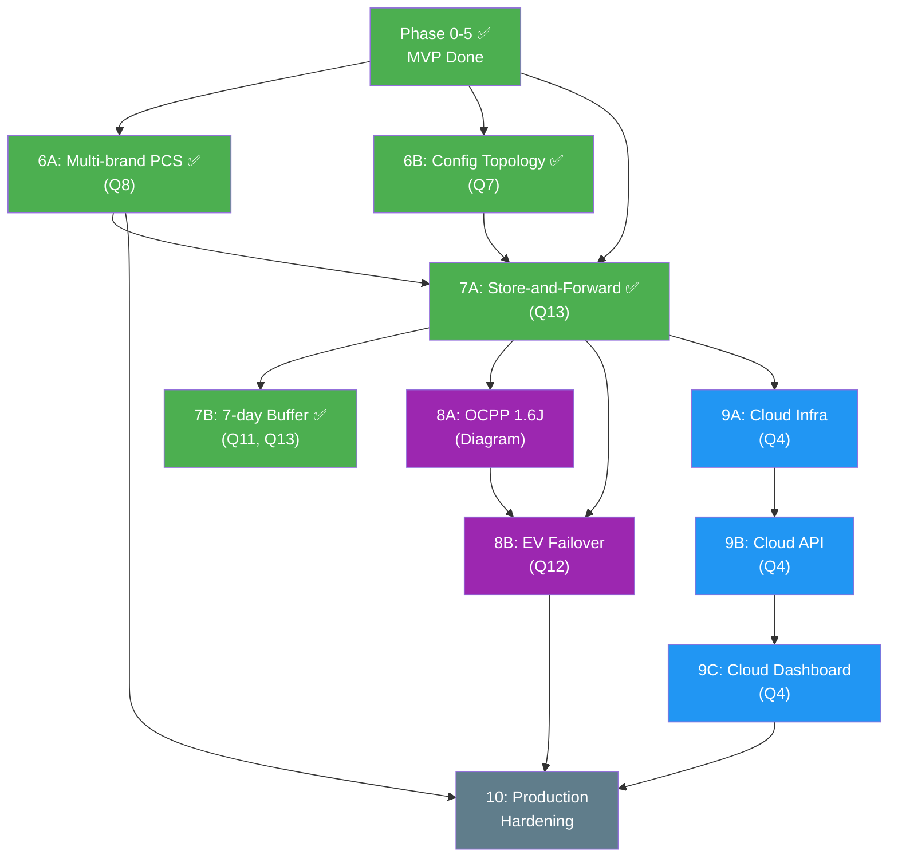
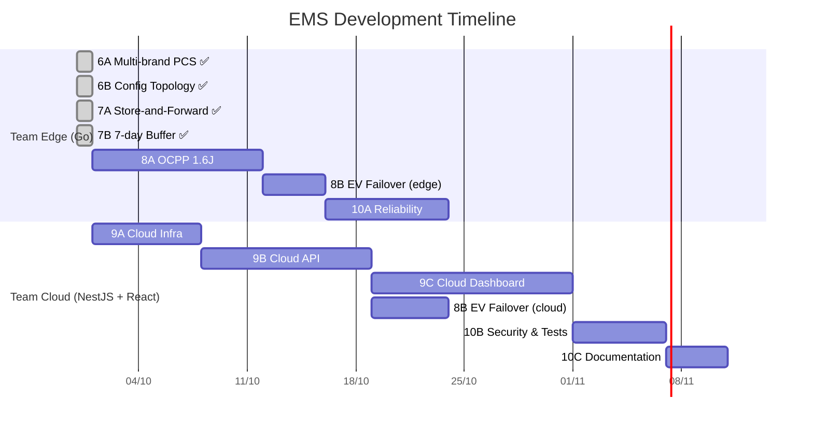

# 📋 EMS Task Plan — Updated per CDI Q&A Requirements

> Historical planning document. For current verified implementation status, see [implementation-status.md](implementation-status.md).

**Cập nhật:** 30/09/2026 15:37  
**Baseline:** [ems-mvp-plan.md](file:///Users/richard/vmo_bid_cdi/docs/ems-mvp-plan.md) + [cloud-erp-plan.md](file:///Users/richard/vmo_bid_cdi/docs/cloud-erp-plan.md)  
**Trigger:** Câu trả lời Q&A từ CDI (28/09/2026)

---

## Trạng thái tổng quan

| Phase | Trạng thái | Tasks Done | Tasks Remaining |
|---|---|---|---|
| Phase 0-5 (MVP cũ) | ✅ Gần hoàn tất | 28/30 | 2 (Task 5.10, 4.2) |
| **Phase 6: Multi-brand & Config** | ✅ Done | 9/9 | 0 |
| **Phase 7: Cloud Sync & Buffer** | ✅ Done | 8/8 | 0 |
| **Phase 8: OCPP & EV Failover** | ✅ Done | 8/8 | 0 |
| **Phase 9: Multi-tenant Cloud** | 🟡 Simulator MVP; UI complete | Dashboard + core API/infra implemented | Production workflows remain |
| **Phase 10: Production Hardening** | 🔴 Mới | 0/10 | 10 |

---

## PHASE 0-5: ĐÃ HOÀN THÀNH (Recap)

Xem danh sách tasks đã done (28 tasks)

- [x] Constraint Resolver PoC + unit tests
- [x] Project structure, go.mod
- [x] Simulator (Fake Modbus Servers)
- [x] Modbus TCP Client (FC03 Read, FC16 Write)
- [x] BMS Adapter (SOC, Temp, Cell Voltage)
- [x] PCS Adapter (Read power, Write setpoint)
- [x] Power Meter Adapter (Power, Voltage, Current, Freq)
- [x] Controller interface + Constraint struct
- [x] Scheduler (FixedOrder)
- [x] ESS Power Resolver
- [x] limit_discharge controller + tests
- [x] sell_to_grid_limit controller + tests
- [x] peak_shaving controller + tests
- [x] time_of_use controller + tests
- [x] balancing controller + tests
- [x] Integration test (all controllers → scheduler → resolver)
- [x] SQLite WAL storage + auto-pruning
- [x] REST API + WebSocket for dashboard
- [x] Health watchdog
- [x] Device Plugin Architecture (Device, ControllableDevice interfaces)
- [x] EV Charger Adapter (Modbus)
- [x] PCS Profile registry (generic/sungrow/sinexcel)
- [x] EV DLM Controller
- [x] Configurable topology via YAML
- [x] EV Dashboard widgets
- [x] Aggregator EV Charger
- [x] Distributor master/individual mode
- [x] SQLite WAL + 7-day auto-retention

### Còn lại từ plan cũ:

- [ ] **Task 5.10**: EV active control — auto WriteMaxPower from DLM controller
- [ ] **Task 4.2**: MQTT sync module (→ chuyển sang Phase 7)

---

## PHASE 6: Multi-brand PCS & Configurable Topology ✅

> **Triggered by:** Q7 (configurable device relationships), Q8 (multi-brand PCS, dual command mode)  
> **Hoàn thành:** 30/09/2026

### Epic 6A: Multi-brand PCS Plugin Architecture ✅

| Task | Mô tả | File | Status |
|---|---|---|---|
| 6.1 | **Define `PCSDriver` interface** — Interface: `ReadState()`, `WriteSetpoint()`, `CommandMode()`, `Brand()`, `Close()` | `internal/devices/pcs_driver.go` | ✅ |
| 6.2 | **GenericPCSDriver** — Wraps `ProfiledPCSAdapter`, implements `PCSDriver` | `internal/devices/pcs_driver_generic.go` | ✅ |
| 6.3 | **Driver loader factory** — Built-in registry → fallback YAML (`config/pcs_profiles/*.yaml`) | `internal/devices/pcs_driver_loader.go` | ✅ |
| 6.4 | **Distributor dual command mode** — Đã có sẵn trong `distributor.go` (master/individual) | `internal/engine/distributor/distributor.go` | ✅ (sẵn) |
| 6.5 | **Unit tests** — 4 tests: read/write, built-in load, custom YAML, register map diff | `internal/devices/pcs_driver_test.go` | ✅ |

**Done:**
- [x] Chạy simulator với 2 driver khác nhau (generic + sinexcel) → cả hai hoạt động đúng
- [x] Thêm brand mới chỉ cần thêm 1 YAML register map file, không sửa Go code

### Epic 6B: Configurable Device Topology ✅

| Task | Mô tả | File | Status |
|---|---|---|---|
| 6.6 | **Topology data model** — `Topology`, `BESSGroup`, `EVCluster`, `DeviceInfo`, `Manager` | `internal/topology/topology.go` | ✅ |
| 6.7 | **Topology API** — GET/PUT `/api/topology`, `/api/topology/devices`, POST `/api/topology/validate` | `internal/topology/api.go` | ✅ |
| 6.8 | **Topology UI** — Sẽ integrate khi làm Phase 10 (documentation/UI polish) | — | ⏳ UI later |
| 6.9 | **BuildFromConfig** — Factory: `config.TopologyConfig` + `config.DevicesConfig` → validated `Manager` | `internal/topology/topology.go` | ✅ |

**Done:**
- [x] Topology REST API hoạt động: GET/PUT/validate
- [x] Validation: check device type, check references exist
- [x] BuildFromConfig tự register devices + tạo default EV cluster

---

## PHASE 7: Cloud Sync & 7-day Buffer ✅

> **Triggered by:** Q13 (5 min sync, 7 days buffer), Q11 (zero data loss locally)  
> **Hoàn thành:** 30/09/2026

### Epic 7A: Store-and-Forward Engine ✅

| Task | Mô tả | File | Status |
|---|---|---|---|
| 7.1 | **Outbox table** — `sync_outbox` (id, payload, created_at, synced_at, status). Full lifecycle: pending→sent→acked | `internal/store/outbox.go` | ✅ |
| 7.2 | **Aggregator 5-min** — `CycleAccumulator`: avg power, min/max SOC, energy Wh. `Flush()` → `TelemetryMessage` JSON | `internal/sync/aggregator.go` | ✅ |
| 7.3 | **Publisher interface** — `Publisher` interface (Connect, Publish, IsConnected, Close) + `StubPublisher` for testing. MQTT swap-in ready | `internal/sync/publisher.go` | ✅ |
| 7.4 | **Syncer + Replay** — Sync loop: tick → flush → outbox → publish. On reconnect: replay pending batch (100 at a time) | `internal/sync/syncer.go` | ✅ |

### Epic 7B: 7-day Ring Buffer & Data Integrity ✅

| Task | Mô tả | File | Status |
|---|---|---|---|
| 7.5 | **Retention policy** — `synced` column migration, `PruneSynced()` chỉ xóa synced records, `MarkCyclesSynced()` | `internal/store/store.go` (modified) | ✅ |
| 7.6 | **Disk space monitor** — `DiskUsage()` (file size + `syscall.Statfs`), `DiskAlert()` (>80% warning) | `internal/store/diskmon.go` | ✅ |
| 7.7 | **Sync status API** — `SyncStatus` struct, `StatusProvider` interface. `GET /api/sync/status`, `GET /api/sync/disk` | `internal/sync/status.go`, `api.go` | ✅ |
| 7.8 | **Sync dashboard widget** — Sẽ integrate khi làm Phase 10 (UI polish) | — | ⏳ UI later |

**Done:**
- [x] Outbox lifecycle: insert → get pending → mark sent → mark acked → prune
- [x] CycleAccumulator: 300 cycles → flush → correct averages & energy Wh
- [x] Syncer replay: 5 pending records → reconnect → all replayed
- [x] Retention: unsynced records KHÔNG BAO GIỜ bị xóa
- [x] `GET /api/sync/status` trả về connection status, pending count, oldest unsynced

---

## PHASE 8: OCPP & EV Failover

> **Triggered by:** Architecture diagram (OCPP), Q12 (Cloud takeover EV), Q3 (6 EV Chargers)  
> **Estimated:** 4-5 tuần  
> **Dependency:** Phase 7 (MQTT cho failover signal)

### Epic 8A: OCPP 1.6J Integration

| Task | Mô tả | Effort | Depends |
|---|---|---|---|
| 8.1 | **OCPP Central System** — Implement OCPP 1.6J WebSocket server (dùng `github.com/lorenzodonini/ocpp-go`). Handle: BootNotification, Heartbeat, StatusNotification, MeterValues | 3d | — |
| 8.2 | **OCPP charge control** — Implement RemoteStartTransaction, RemoteStopTransaction, SetChargingProfile (power limit) | 3d | 8.1 |
| 8.3 | **EV Charger adapter — OCPP mode** — Extend `EVChargerAdapter` để hỗ trợ cả Modbus mode VÀ OCPP mode. Config chọn mode per charger: `protocol: "ocpp"` hoặc `protocol: "modbus"` | 2d | 8.2 |
| 8.4 | **OCPP unit tests** — Mock OCPP charger client → test full flow: connect → boot → charge → meter values → stop | 2d | 8.3 |

### Epic 8B: Cloud Failover cho EV Charger

| Task | Mô tả | Effort | Depends |
|---|---|---|---|
| 8.5 | **Heartbeat publisher** — Local EMS gửi heartbeat mỗi 30s qua MQTT topic `ems/{site_id}/heartbeat`. Payload: timestamp, status, EV charger states | 1d | 7.3 |
| 8.6 | **Failover detector (Cloud side)** — Cloud service monitor heartbeat. Nếu miss 3 heartbeat liên tiếp (90s) → trigger failover mode | 2d | 8.5 |
| 8.7 | **Cloud EV controller** — Khi failover active: Cloud gửi OCPP commands trực tiếp cho EV Chargers qua backup connection. Basic safe mode: giới hạn max power, không charge mới | 3d | 8.6, 8.2 |
| 8.8 | **Failover recovery** — Khi Local EMS heartbeat resume → Cloud chuyển control về Local EMS. Handshake protocol tránh conflict commands | 2d | 8.7 |

**Done when:**
- [ ] 6 EV Charger kết nối qua OCPP → hiển thị status trên dashboard
- [ ] Kill Local EMS process → 90s sau Cloud takeover → EV Charger vẫn hoạt động ở safe mode
- [ ] Restart Local EMS → control chuyển về Local trong vòng 30s, không interrupt charging session

---

## PHASE 9: Multi-tenant Cloud Platform

> **Triggered by:** Q4 (multi-customer, individual account), Q1 (commercial product)  
> **Estimated:** 5-6 tuần  
> **Dependency:** Phase 7 (MQTT sync data)

> **Implementation update — 16/10/2026:** Phase 9C is complete at the responsive UI/demo level. The Dockerized Cloud simulator, tenant-scoped API, MQTT ingestion and core dashboard data path are operational. Phase 9 is still marked partial because production provisioning, database RLS, alert delivery and remote configuration writes are not complete. See [implementation-status.md](implementation-status.md) for the verified status.

### Epic 9A: Cloud Infrastructure

| Task | Mô tả | Effort | Depends |
|---|---|---|---|
| 9.1 | **Docker Compose dev environment** — EMQX + PostgreSQL + TimescaleDB + Redis + NestJS. `docker compose up` chạy toàn bộ | 2d | — |
| 9.2 | **Database schema** — Tables: `tenants`, `sites`, `users`, `roles`, `devices`, `telemetry` (TimescaleDB hypertable). Row-level security per tenant | 3d | 9.1 |
| 9.3 | **MQTT consumer service** — Subscribe `ems/+/telemetry` → parse → insert TimescaleDB. Handle per-site routing | 2d | 9.1 |

### Epic 9B: Backend API (NestJS)

| Task | Mô tả | Effort | Depends |
|---|---|---|---|
| 9.4 | **Auth module** — JWT-based auth. Login, register, refresh token. Tenant isolation middleware (user chỉ access data của tenant mình) | 3d | 9.2 |
| 9.5 | **Site management API** — CRUD sites, assign devices to site, provision new site (generate MQTT credentials + site config) | 3d | 9.4 |
| 9.6 | **Telemetry API** — Query time-series data theo site, time range, aggregation (1min/5min/1h/1d). Pagination | 2d | 9.3 |
| 9.7 | **Alert API** — CRUD alert rules (threshold, condition). Evaluate incoming data. Send notification (email/webhook) | 3d | 9.6 |

### Epic 9C: Cloud Dashboard (React)

| Task | Mô tả | Effort | Depends |
|---|---|---|---|
| 9.8 | **Project setup** — React + Vite + Ant Design + React Router. Auth pages (login/register) | 2d | 9.4 |
| 9.9 | **Fleet overview page** — Danh sách tất cả sites của tenant. Status card mỗi site (online/offline, total power, SOC, alerts) | 3d | 9.5, 9.6 |
| 9.10 | **Site detail page** — Energy flow diagram (giống local dashboard), historical charts (ECharts), device list | 3d | 9.9 |
| 9.11 | **Alert management page** — Hiển thị active alerts, history, config rules | 2d | 9.7 |
| 9.12 | **Remote config page** — Cập nhật control strategy, topology cho từng site. Push config xuống Local EMS qua MQTT | 3d | 9.5 |

### Phase 9C UI implementation status

| Scope | Status | Notes |
|---|---|---|
| Project setup and authentication | ✅ UI/MVP complete | Vite, React, TypeScript, Tailwind, shared shadcn-style components, Radix UI and React Query; login, refresh session and logout |
| Responsive application shell | ✅ UI complete | Desktop, tablet and mobile sidebar/header/navigation layouts |
| Tenant experience | ✅ UI demo complete | Tenant A uses the live simulator; Tenant B is explicitly labelled as a preview dataset |
| Fleet and site monitoring | ✅ UI complete | Overview, Live Energy, Sites, Devices and ECharts visualizations |
| Operations | ✅ UI complete | Commands, Alerts, Reports and notification panel; some actions remain demo-only until their APIs are completed |
| Administration and support | ✅ UI complete | Settings, Profile Settings and Help Center |
| Alert rule configuration and delivery | ⏳ Backend integration remaining | Rule CTA/UI exists; CRUD evaluation and email/webhook delivery are not implemented |
| Remote configuration push | ⏳ Backend integration remaining | Settings UI exists; audited MQTT delivery to Local EMS is not implemented |

Cloud UI screenshots: `docs/screenshots/cloud-login.png`, `cloud-overview.png`, `cloud-notifications.png`, `cloud-sites-tenant-b.png`, `cloud-profile.png`, and `cloud-help-center.png`.

**Done when:**
- [ ] Tạo 2 tenant (Customer A, Customer B) → mỗi tenant thấy site riêng, không thấy site của nhau
- [ ] Local EMS push data → Cloud dashboard hiển thị real-time
- [ ] Tạo alert rule "SOC < 10%" → nhận email notification khi trigger

---

## PHASE 10: Production Hardening

> **Triggered by:** Q11 (hot-reload), Q1 (product-grade)  
> **Estimated:** 3-4 tuần  
> **Dependency:** Phase 6-9 hoàn tất

### Epic 10A: Reliability

| Task | Mô tả | Effort | Depends |
|---|---|---|---|
| 10.1 | **Config hot-reload** — Watch config file changes + API endpoint `POST /api/config/reload`. Thay đổi IP device, thêm/bớt device không cần restart | 2d | 6.6 |
| 10.2 | **Per-device health monitoring** — Track connection status, error rate, response time cho từng device. Auto-reconnect. Dashboard hiển thị device health | 2d | — |
| 10.3 | **Fire protection handler** — Khi BMS báo fire alarm → emergency stop toàn bộ PCS trong BESS group đó. Log event. Push alert lên Cloud | 2d | — |
| 10.4 | **Graceful degradation** — Nếu 1 PCS disconnect, distributor tự loại khỏi pool. Nếu PCC meter disconnect, engine chuyển sang safe mode (stop discharge) | 2d | 6.4 |

### Epic 10B: Quality & Security

| Task | Mô tả | Effort | Depends |
|---|---|---|---|
| 10.5 | **Integration test suite** — End-to-end test: simulator → engine → MQTT → Cloud → dashboard. Automated CI | 3d | 9.3 |
| 10.6 | **TLS cho Modbus & MQTT** — TLS encryption cho tất cả communication channels | 2d | — |
| 10.7 | **Audit logging** — Log tất cả command writes (ai, lúc nào, giá trị gì). Immutable audit trail | 1d | — |
| 10.8 | **Structured logging** — Slog/Zap structured logging. Log levels per module. Log rotation | 1d | — |

### Epic 10C: Documentation

| Task | Mô tả | Effort | Depends |
|---|---|---|---|
| 10.9 | **API documentation** — OpenAPI/Swagger cho REST API (Local + Cloud) | 2d | — |
| 10.10 | **Operator manual** — Deployment guide, configuration guide, troubleshooting | 2d | — |

---

## Dependency Graph tổng thể

## Song song hóa (2 teams)

---

## Tổng effort ước tính

| Phase | Tasks | Effort (man-days) | Status |
|---|---|---|---|
| Phase 6: Multi-brand & Config | 9 tasks | ~20 days | ✅ Done |
| Phase 7: Cloud Sync & Buffer | 8 tasks | ~13 days | ✅ Done |
| Phase 8: OCPP & EV Failover | 8 tasks | ~18 days | 🔴 Next |
| Phase 9: Cloud Platform | 12 tasks | ~28 days | 🔴 Planned |
| Phase 10: Hardening | 10 tasks | ~17 days | 🔴 Planned |
| **Total** | **47 tasks** | **~96 man-days** | **17/47 done** |

> Với team 6-7 người song song, timeline ước tính: **~18-22 tuần** từ kickoff đến production-ready.
> 
> **Note:** Phase 6 & 7 hoàn thành ngày 30/09/2026. Task 6.8 (Topology UI) và 7.8 (Sync widget) sẽ làm trong Phase 10.
