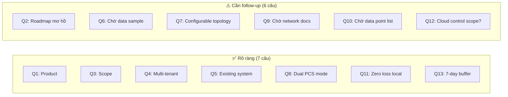
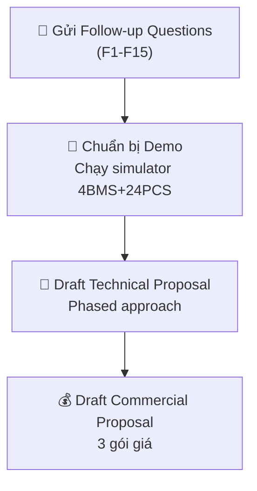

# 📋 BID ANALYSIS REPORT v2 — CDI Energy Management System

**Ngày cập nhật:** 30/09/2026  
**Dự án:** Local EMS cho hệ thống BESS + Cloud Platform (Multi-site, Multi-tenant)  
**Khách hàng:** CDI  
**Trạng thái:** Q&A đã có câu trả lời — cần follow-up một số điểm

---

## 🔑 TÓM TẮT THAY ĐỔI SO VỚI v1

> [!IMPORTANT]
> Sau khi nhận câu trả lời, bức tranh dự án đã thay đổi đáng kể:
> 1. **Đây là SẢN PHẨM thương mại**, không phải internal platform → cần product-grade architecture
> 2. **Multi-site, multi-customer** với individual account → cần multi-tenant Cloud
> 3. **PCS đến từ nhiều hãng khác nhau** → cần device abstraction layer + plugin driver
> 4. **Cloud phải takeover control** khi Local EMS fail → Cloud không chỉ là monitoring
> 5. **Zero data loss locally**, Cloud sync mỗi 5 phút, buffer 7 ngày

---

## 📊 1. Phân tích chi tiết câu trả lời khách hàng

### Bảng tổng hợp Q&A

| # | Chủ đề | Câu trả lời (tóm tắt) | Mức độ rõ ràng | Nhận xét |
|---|---|---|---|---|
| Q1 | Business Goal | Sản phẩm thương mại cho khách hàng | ✅ Rõ | Thay đổi scope: cần product-grade, không phải one-off |
| Q2 | Roadmap | Data Collection & Controlling | ⚠️ Hơi mơ hồ | Chưa rõ roadmap dài hạn (analytics, forecasting?) |
| Q3 | Scope Phase 1 | Collect → Calculate → Write. BMS:4, PCS:24, EV:6, Meter:3. Per site. Plan to scale | ✅ Rõ | **Số lượng EV Charger = 6** (sơ đồ chỉ vẽ 3) |
| Q4 | Multi-site | Nhiều customer, nhiều location. Cloud + individual account | ✅ Rõ | → **Multi-tenant SaaS architecture** |
| Q5 | Existing system | Đã có meter, sensor. Access qua API & Modbus on-site | ✅ Rõ | Không bắt đầu từ zero, cần tích hợp |
| Q6 | Data sample | Sẽ share. Đang chờ vendor cung cấp address | ⚠️ Pending | Chưa có data → chưa thể validate register map |
| Q7 | PCC Meter selection | Muốn hệ thống cho phép **chọn** relationship giữa thiết bị | ⚠️ Quan trọng | → Cần **configurable device topology UI** |
| Q8 | PCS command mode | **Cả hai**: Master command VÀ individual command (tùy brand) | ✅ Rõ nhưng phức tạp | → Cần **multi-brand PCS driver + command mode config** |
| Q9 | Network topology | Đang thu thập từ vendor | ⚠️ Pending | Blocking item cho implementation |
| Q10 | Data point 200ms vs 5s | "Yes" (sẽ cung cấp) | ⚠️ Pending | Chưa có danh sách cụ thể |
| Q11 | Dynamic config & data loss | Device/IP có thể thay đổi. **Zero data loss locally**. Cloud: 5 min interval | ✅ Rõ | → Hot-reload config + reliable local storage |
| Q12 | Backup Connection | Cloud **takeover control** khi Local EMS fail (cho EV Charger) | ✅ Rõ nhưng complexity cao | → **Cloud cần control path, không chỉ monitoring** |
| Q13 | Cloud sync | 5 min interval. **7 ngày buffer locally** | ✅ Rõ | → Store-and-forward + 7-day ring buffer |

### Phân tích tổng thể

---

## ❓ 2. Câu hỏi Follow-up cần đặt thêm

> [!WARNING]
> Dựa trên câu trả lời, có **nhiều yêu cầu mới xuất hiện** cần clarify trước khi bid chính xác.

### 🔴 Critical — Phải hỏi trước khi bid

#### Nhóm A: Technical Architecture

| # | Câu hỏi | Tại sao cần |
|---|---|---|
| F1 | **"Cloud takeover control for EV Charger"** — Khi Local EMS fail, Cloud gửi command trực tiếp cho EV Charger qua internet hay qua một local backup controller? Latency chấp nhận được là bao nhiêu? | Đây là yêu cầu phức tạp nhất. Cloud control qua internet có latency, không phù hợp cho real-time safety-critical control. Cần clarify kiến trúc failover |
| F2 | Q7 nói muốn **"choose relationship of equipment"** — Có nghĩa là UI cho phép drag-drop/config thiết bị nào là PCC meter, thiết bị nào thuộc group nào? Hay chỉ cần config file? | Quyết định effort cho configuration UI |
| F3 | **6 EV Charger** (thay vì 3 trong sơ đồ) — Tất cả cùng hãng không? Giao tiếp qua OCPP 1.6J hay Modbus? Có central Switch/controller không? | Ảnh hưởng protocol choice |

#### Nhóm B: Control Strategy

| # | Câu hỏi | Tại sao cần |
|---|---|---|
| F4 | **"Calculate Power according to given strategy"** — Strategy cụ thể là gì? Peak shaving? Time-of-Use? Self-consumption? Hay khách hàng sẽ define strategy riêng? | Cốt lõi của EMS — cần biết rõ business logic |
| F5 | Khách hàng có **bao nhiêu strategy** cần implement cho Phase 1? Có cần strategy editor/builder trên UI không? | Quyết định complexity của engine |
| F6 | Khi có **nhiều brand PCS** — mỗi site dùng 1 brand hay mix nhiều brand? Ai cung cấp register map cho từng brand? | Quyết định driver development effort |

#### Nhóm C: Cloud & Multi-tenant

| # | Câu hỏi | Tại sao cần |
|---|---|---|
| F7 | **Individual account** — Có cần role-based access (admin, operator, viewer)? Có cần organization/company hierarchy? | Quyết định auth & permission architecture |
| F8 | Cloud platform cần những **tính năng gì** cho Phase 1? (Monitoring dashboard? Reporting? Remote config? Firmware update? Alerting?) | Quyết định scope Cloud development |
| F9 | Bao nhiêu **site** dự kiến trong 1 năm đầu? (5? 50? 500?) | Quyết định infrastructure sizing |

### 🟡 Important — Nên hỏi

| # | Câu hỏi | Tại sao cần |
|---|---|---|
| F10 | Fire Protection: Khi BMS phát hiện fire → EMS phải làm gì cụ thể? Emergency shutdown toàn bộ hay từng PCS? | Safety-critical logic |
| F11 | **Timeline mong muốn** cho Phase 1? | Quyết định resource allocation |
| F12 | Ai chịu trách nhiệm **hardware, network, deployment on-site**? VMO chỉ làm software? | Scope boundary |
| F13 | Có yêu cầu **certification/compliance** không? (IEC 62443, ISO 50001, v.v.) | Ảnh hưởng testing & documentation |
| F14 | **Testing & commissioning** — Có site access cho testing? Có sandbox/staging environment? | Timeline & cost |
| F15 | **Warranty & SLA** sau go-live? Response time? Uptime commitment? | Commercial terms |

---

## 🎯 3. Chiến lược Bid (Cập nhật)

### 3.1 Thay đổi chiến lược sau Q&A

| Trước Q&A | Sau Q&A |
|---|---|
| Nghĩ là internal tool | → **Sản phẩm thương mại** → cần product-grade UX, multi-tenant, scalability |
| Single-site focus | → **Multi-site, multi-customer** → cần Cloud fleet management |
| PCS Master command only | → **Multi-brand PCS** với dual command mode → cần plugin architecture |
| Cloud chỉ monitoring | → **Cloud phải control EV khi Local fail** → cần failover architecture |
| Simple config | → **Configurable device topology** → cần configuration UI |

### 3.2 Phased Delivery (Cập nhật)

#### Phase 1: Local EMS Core + Basic Cloud (10-12 tuần)

| Module | Deliverable | Effort |
|---|---|---|
| **Data Acquisition** | Modbus TCP polling: 3 Power Meters, 4 BMS, 24 PCS, 6 EV Chargers | 2-3 tuần |
| **Multi-brand PCS Driver** | Plugin-based driver architecture (Master cmd + Individual cmd modes) | 2-3 tuần |
| **Control Engine** | Configurable strategy engine (peak shaving, balancing, SOC protection) | 1-2 tuần (đã có ~80%) |
| **Configurable Topology** | UI/config cho phép define device relationships, PCC meter selection | 2 tuần |
| **Local Storage** | SQLite WAL-mode, 7-day ring buffer, zero data loss | 1 tuần (đã có ~70%) |
| **Local Dashboard** | Real-time monitoring, energy flow, device status | 1 tuần (đã có ~80%) |
| **Cloud Sync** | MQTT store-and-forward, 5-min interval, 7-day buffer replay | 2 tuần |
| **Basic Cloud** | Multi-tenant auth, per-customer data isolation, basic dashboard | 3-4 tuần |

#### Phase 2: EV Integration + Cloud Control (8-10 tuần)

| Module | Deliverable | Effort |
|---|---|---|
| **OCPP 1.6J** | EV Charger management qua Switch | 3-4 tuần |
| **Cloud Failover** | Cloud takeover EV control khi Local EMS fail | 2-3 tuần |
| **Advanced Dashboard** | Cloud fleet view, alerting, reporting | 2-3 tuần |
| **FDD & Alerting** | Fault detection, email/SMS notification | 1-2 tuần |

#### Phase 3: Product Maturity (6-8 tuần)

| Module | Deliverable | Effort |
|---|---|---|
| **Multi-site Deployment** | Automated provisioning, firmware OTA | 2-3 tuần |
| **Strategy Editor** | Visual strategy builder cho từng site | 2-3 tuần |
| **Analytics & Reporting** | Historical analysis, energy cost reports | 2 tuần |
| **Security Hardening** | TLS, cert management, audit logging | 1-2 tuần |

### 3.3 Team Composition đề xuất

| Role | Số lượng | Ghi chú |
|---|---|---|
| **Tech Lead / Go Engineer** | 1 | Core engine, Modbus, device drivers |
| **Go Backend Engineer** | 1-2 | Cloud sync, storage, API |
| **Frontend Engineer** | 1 | Dashboard UI, configuration UI |
| **Cloud/DevOps Engineer** | 1 | Multi-tenant infra, MQTT broker, CI/CD |
| **QA Engineer** | 1 | Integration testing, hardware-in-loop |
| **PM/BA** | 1 | Khách hàng communication, spec management |
| **Total** | 6-7 | |

---

## 💻 4. Codebase Assessment (Cập nhật theo Q&A)

### 4.1 ✅ Đã đáp ứng — Tác động của câu trả lời

| Component hiện tại | Đáp ứng yêu cầu nào | Cần modify? |
|---|---|---|
| `internal/modbus/client.go` — Modbus TCP | Q5: Access qua Modbus ✅ | Không |
| `internal/devices/bms.go` — BMS 4 units | Q3: BMS 4 units ✅ | Cần thêm register map theo vendor thực tế |
| `internal/devices/pcs.go` — PCS adapter | Q3: PCS 24 units ✅ | 🔴 **Cần refactor lớn**: support multi-brand + dual command mode (Q8) |
| `internal/devices/meter.go` — Power Meter | Q3: 3 meters ✅ | Cần extend cho configurable PCC selection (Q7) |
| `internal/devices/evcharger.go` — EV Charger | Q3: 6 EV chargers | ⚠️ Hiện chỉ support Modbus, cần thêm OCPP |
| `internal/engine/controllers/` — 6 strategies | Q1: Control theo strategy ✅ | Cần thêm config-driven strategy selection |
| `internal/engine/distributor/` — Multi-PCS | Q8: Distribute command ✅ | Cần extend cho per-brand distribution mode |
| `internal/store/store.go` — SQLite storage | Q11: Zero data loss local ✅ | Cần extend ring buffer cho 7-day retention (Q13) |
| `internal/simulator/` — Simulator | Demo capability ✅ | Mở rộng cho 4 BMS + 24 PCS scale |
| `internal/ui/dashboard.go` — Dashboard | Local monitoring ✅ | Cần tách frontend + thêm config UI (Q7) |

### 4.2 ❌ Cần phát triển mới — Ưu tiên theo Q&A

| Component mới | Triggered bởi | Priority | Effort |
|---|---|---|---|
| **Multi-brand PCS Plugin Architecture** | Q8: "Both modes, different brands" | 🔴 P0 | 2-3 tuần |
| **Configurable Device Topology** | Q7: "Choose relationship of equipment" | 🔴 P0 | 2 tuần |
| **MQTT Store-and-Forward** | Q13: "5 min, 7 days buffer" | 🔴 P0 | 2 tuần |
| **Multi-tenant Cloud Platform** | Q4: "Multiple customer, individual account" | 🔴 P0 | 4-6 tuần |
| **Cloud Failover Controller** | Q12: "Cloud takeover control" | 🔴 P0 | 2-3 tuần |
| **OCPP 1.6J Client** | Q3: "6 EV Chargers" + architecture diagram | 🟡 P1 | 3-4 tuần |
| **Hot-reload Configuration** | Q11: "Device replacement, IP changes" | 🟡 P1 | 1-2 tuần |
| **Fire Protection / E-Stop** | Architecture diagram: "Fire Protection" | 🟡 P1 | 1-2 tuần |
| **FDD & Alerting Engine** | Product-grade requirement (Q1) | 🟡 P1 | 2 tuần |
| **Cloud Dashboard (Fleet)** | Q4: Multi-site monitoring | 🟡 P1 | 3-4 tuần |
| **CAN bus Gateway** | Architecture: PCS ↔ BMS via CANbus | 🟢 P2 | 1-2 tuần |
| **TimescaleDB Backend** | Production scale (thousands of data points) | 🟢 P2 | 1-2 tuần |

### 4.3 🔧 Refactoring cần thiết

| Hiện tại | Cần thay đổi | Lý do |
|---|---|---|
| PCS adapter cứng 1 brand | → **Plugin-based PCS driver** với interface `PCSDriver` | Q8: Multi-brand, dual command mode |
| Device topology hardcoded trong YAML | → **Runtime-configurable topology** với UI | Q7: Customer chọn relationship |
| Frontend embedded trong Go | → **Tách frontend project** (React/Vue) | Product-grade UI, configurable topology editor |
| SQLite chỉ pruning by time | → **7-day ring buffer** với guaranteed retention | Q13: 7 ngày buffer |
| Single-site config | → **Site-aware config** với unique site ID | Q3, Q4: Multi-site product |
| Control strategies hardcoded enable/disable | → **Strategy config per-site** với API | Q1: Product cho nhiều customer |

---

## 🚀 5. Action Plan cụ thể

### Tuần 1 (30/9 - 4/10)

- [ ] Gửi **15 câu hỏi follow-up** cho khách hàng (ưu tiên F1, F4, F6, F8)
- [ ] Cập nhật simulator config cho đúng scale: 4 BMS, 24 PCS, 6 EV, 3 Meter
- [ ] Quay **video demo** chạy simulator + dashboard
- [ ] Draft technical architecture document

### Tuần 2 (7/10 - 11/10)

- [ ] Nhận câu trả lời follow-up → refine scope
- [ ] Nhận **data sample** từ vendor (Q6)
- [ ] Hoàn thiện **Technical Proposal**
- [ ] Hoàn thiện **Commercial Proposal** với 3 gói giá
- [ ] Review nội bộ

### Tuần 3 (14/10 - 18/10)

- [ ] **Submit Bid**
- [ ] Chuẩn bị **presentation deck** cho defense meeting
- [ ] Chuẩn bị **live demo** (nếu được mời)

### Song song — Chuẩn bị kỹ thuật (nếu confident sẽ win)

- [ ] **POC: Multi-brand PCS plugin** — tạo interface + 1 sample driver
- [ ] **POC: MQTT sync** — implement basic store-and-forward
- [ ] **Research OCPP 1.6J** Go library (github.com/lorenzodonini/ocpp-go)

---

## 📊 6. Risk Assessment (Cập nhật)

| Risk | Impact | Prob. | Mitigation |
|---|---|---|---|
| 🔴 **Cloud failover control** (Q12) — phức tạp hơn dự kiến | High | High | Clarify F1 ngay. Nếu cần real-time cloud control → cần redundant local controller |
| 🔴 **Multi-brand PCS** (Q8) — chưa biết brand nào | High | Medium | Yêu cầu danh sách brand + register map. Design plugin architecture trước |
| 🟡 **Chưa có data sample** (Q6, Q9, Q10) | Medium | High | Set deadline nhận data. Dùng simulator để develop trước |
| 🟡 **Scope creep** — Product vs Project | High | Medium | Fix scope Phase 1 rõ ràng trong contract |
| 🟡 **Multi-tenant security** (Q4) | Medium | Medium | Dùng proven pattern (tenant isolation, row-level security) |
| 🟢 **200ms polling performance** | Low | Low | Go goroutine model đủ khả năng |

---

## 💡 7. Đề xuất chiến lược thuyết phục khách hàng

### Điểm mạnh để highlight trong proposal:

1. **"Chúng tôi đã có Working Engine"** — Demo chạy thực, không phải slide
2. **"Lightweight & Rugged"** — Go binary 15MB chạy trên ARM gateway, không cần JVM/Python
3. **"Constraint-based Architecture"** — An toàn: safety controller luôn thắng, không bao giờ override nhau
4. **"Plugin PCS Driver"** — Design sẵn cho multi-brand, thêm brand mới chỉ cần thêm driver
5. **"Battle-tested Patterns"** — Tham khảo OpenEMS (edge control) + MyEMS (energy accounting)
6. **"Product-ready"** — Multi-tenant Cloud + per-site config → deploy cho customer mới nhanh

### Điểm cần cẩn trọng:

1. **Cloud failover** — Nên đề xuất **redundant local controller** thay vì cloud control qua internet (latency risk)
2. **CAN bus** — Nên đề xuất dùng **CAN-to-Modbus gateway** (phần cứng) thay vì implement CAN bus trong software
3. **Pricing** — Vì đây là product → có thể đề xuất **licensing model** (per-site fee) bên cạnh development cost

---

> [!NOTE]
> **Tóm tắt v2:** Câu trả lời khách hàng cho thấy đây là **sản phẩm thương mại multi-tenant** phức tạp hơn dự kiến ban đầu. Codebase hiện tại vẫn đáp ứng ~55-60% cho Local EMS core, nhưng cần **refactoring đáng kể** (multi-brand PCS, configurable topology) và **phát triển mới** (Cloud platform, failover, OCPP). Rủi ro lớn nhất hiện tại là **Cloud failover architecture** (Q12) và **thiếu hardware spec** (Q6, Q9). Cần push khách hàng trả lời F1 và F4 trước khi finalize bid.
