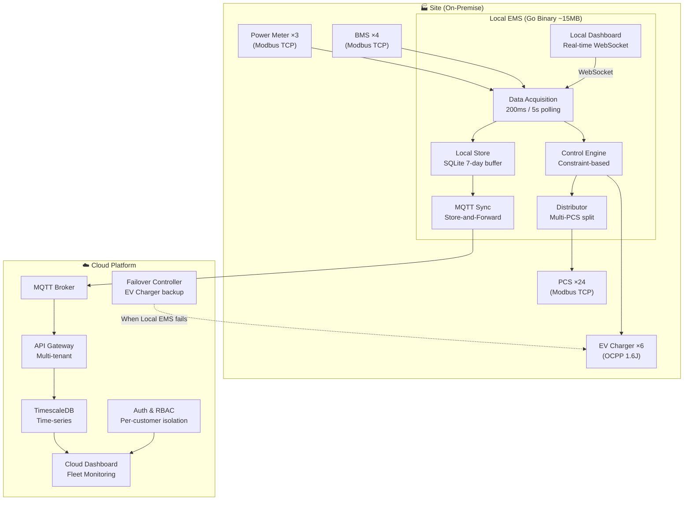
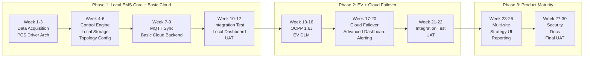

# TECHNICAL & COMMERCIAL PROPOSAL

## Energy Management System (EMS)
### Local EMS + Cloud Platform for Battery Energy Storage Systems

---

| | |
|---|---|
| **Prepared for** | CDI |
| **Prepared by** | VMO Holdings |
| **Date** | 30/09/2026 |
| **Version** | 1.0 — Draft |
| **Validity** | 30 days from date of issue |

---

## Table of Contents

1. [Executive Summary](#1-executive-summary)
2. [Understanding of Requirements](#2-understanding-of-requirements)
3. [Proposed Solution](#3-proposed-solution)
4. [Scope of Work](#4-scope-of-work)
5. [Technology Stack](#5-technology-stack)
6. [Team Composition](#6-team-composition)
7. [Project Timeline](#7-project-timeline)
8. [Assumptions & Dependencies](#8-assumptions--dependencies)
9. [Open Items](#9-open-items)
10. [Why VMO](#10-why-vmo)

---

## 1. Executive Summary

VMO Holdings proposes to develop a **commercial-grade Energy Management System (EMS)** for CDI, designed as a **multi-site, multi-customer product** that collects real-time data from Battery Energy Storage Systems (BESS), Power Conversion Systems (PCS), Power Meters, and EV Chargers — and controls charge/discharge operations according to configurable strategies.

The solution consists of two tiers:

- **Local EMS** — A lightweight, high-performance edge controller deployed on-site, handling real-time data acquisition and equipment control with sub-second response times
- **Cloud Platform** — A centralized multi-tenant platform providing fleet monitoring, data storage, reporting, and failover control for EV Chargers

**Key differentiator:** VMO has an **existing, working EMS engine** written in Go — including Modbus TCP communication, 6 control strategies, multi-PCS power distribution, real-time dashboard, and a full system simulator — enabling faster delivery and lower risk compared to building from scratch.

---

## 2. Understanding of Requirements

### 2.1 System Architecture

Based on the provided architecture diagram and Q&A discussions, the system encompasses:


### 2.2 Hardware Scope (Per Site)

| Equipment | Quantity | Communication | Role |
|---|---|---|---|
| **BMS** | 4 units | Modbus TCP/Ethernet | Battery state monitoring (SOC, temperature, cell voltage, fire protection) |
| **PCS** | 24 units | Modbus TCP/Ethernet | Power conversion — receives charge/discharge commands |
| **Power Meter** | 3 units | Modbus TCP/Ethernet | Grid import/export measurement (~150 data points) |
| **EV Charger** | 6 units | OCPP via Ethernet Switch | Electric vehicle charging management |

### 2.3 Core Requirements (from Q&A)

| # | Requirement | Source |
|---|---|---|
| R1 | **Product for multiple customers** — EMS will be offered as a commercial product to CDI's end customers | Q1 |
| R2 | **Data Collection & Control** — Collect data from all equipment, calculate power according to given strategy, write commands to PCS/EV Charger | Q2, Q3 |
| R3 | **Multi-site, multi-customer** — Each customer accesses their own data via individual Cloud account | Q4 |
| R4 | **Multi-brand PCS support** — Both Master command and individual PCS command modes must be supported, as PCS brands vary across sites | Q8 |
| R5 | **Configurable device topology** — System allows users to define relationships between equipment (e.g., which meter is the PCC meter) | Q7 |
| R6 | **Integration with existing systems** — Sites already have energy meters and sensors accessible via API and Modbus | Q5 |
| R7 | **Zero data loss locally** — No data loss on the Local EMS during normal operation or communication failures | Q11 |
| R8 | **Cloud sync every 5 minutes** with **7-day local buffer** when Cloud connection is unavailable | Q13 |
| R9 | **Hot-reconfigurable** — Support device replacement, IP changes, and data point changes without system restart | Q11 |
| R10 | **Cloud failover for EV Chargers** — Cloud takes over EV Charger control if Local EMS fails | Q12 |

### 2.4 Data Acquisition Requirements

| Data Type | Refresh Rate | Volume |
|---|---|---|
| Critical power meter data | Every **200 ms** | ~20-30 key data points |
| Standard data points | Every **5 seconds** | ~150+ data points per meter; hundreds per BMS/PCS |
| Cloud synchronization | Every **5 minutes** | Aggregated summaries |
| Local data retention | **7 days** minimum | ~18M records, estimated 2-5 GB |

---

## 3. Proposed Solution

### 3.1 Architecture Overview



### 3.2 Local EMS — Edge Controller

The Local EMS runs as a **single Go binary (~15MB)** on an industrial edge gateway (Linux ARM64/x86). It requires no external runtime (no JVM, no Python, no Docker).

**Core control loop (1-second cycle):**

```
READ → SCHEDULE → ADVISE → RESOLVE → DISTRIBUTE → WRITE
  │        │          │         │           │          │
  │        │          │         │           │          └─ Write setpoints to PCS/EV
  │        │          │         │           └─ Split power across 24 PCS units
  │        │          │         └─ Clamp power within safety constraints
  │        │          └─ Each strategy suggests desired power
  │        └─ Run all enabled controllers in priority order
  └─ Poll all devices via Modbus TCP
```

**Key design principles:**
- **Constraint-based resolution** — Safety controllers (SOC protection, grid limits) always override optimization controllers (peak shaving, ToU). Controllers never conflict
- **Plugin-based PCS drivers** — Each PCS brand is a separate driver module. Adding a new brand = adding a configuration file, no core code changes
- **Configurable device topology** — Device relationships, PCC meter selection, and control strategies are configurable per site via UI or API

### 3.3 Cloud Platform — Fleet Management

| Capability | Description |
|---|---|
| **Multi-tenant data isolation** | Each customer sees only their own sites and data |
| **Fleet dashboard** | Real-time overview of all sites, alerts, status |
| **Historical data storage** | TimescaleDB for long-term time-series data |
| **EV Failover control** | Monitors Local EMS heartbeat; takes over EV Charger commands if Local EMS is unresponsive |
| **Remote configuration** | Update site topology, control strategies, and device parameters remotely |
| **User management** | Role-based access control (Admin, Operator, Viewer) |

---

## 4. Scope of Work

### Phase 1: Local EMS Core + Basic Cloud — *10-12 weeks*

> [!IMPORTANT]
> Phase 1 delivers a **fully functional Local EMS** capable of data collection and equipment control for one site, plus basic Cloud connectivity.

| Module | Deliverables | Status |
|---|---|---|
| **Data Acquisition** | Modbus TCP polling from 3 Power Meters, 4 BMS, 24 PCS at configured intervals (200ms / 5s) | 🟡 70% existing — extend for multi-rate polling |
| **PCS Driver Architecture** | Plugin-based driver interface supporting Master command mode and Individual command mode | ✅ Done — `PCSDriver` interface + `GenericPCSDriver` + YAML loader |
| **Control Engine** | Configurable strategy execution: Balancing, Peak Shaving, SOC Protection, Grid Export Limit | ✅ Done |
| **Multi-PCS Distributor** | Split aggregated power setpoint across 24 PCS units (Equal, Round-robin, Group modes) | ✅ Done |
| **Configurable Topology** | API + UI for defining device relationships, selecting PCC meter, grouping PCS units | ✅ Done (API) — UI deferred to Phase 2 |
| **Local Storage** | SQLite WAL-mode with 7-day ring buffer, zero data loss guarantee | ✅ Done — synced column + PruneSynced + DiskMonitor |
| **MQTT Cloud Sync** | Store-and-forward uplink to Cloud, 5-minute intervals, automatic replay on reconnect | ✅ Done — Outbox + CycleAccumulator + Syncer + Publisher interface |
| **Local Dashboard** | Real-time energy flow diagram, device status, WebSocket live updates | ✅ 80% existing |
| **Basic Cloud Backend** | MQTT ingestion, multi-tenant API, TimescaleDB storage, basic web dashboard | 🔴 New development |
| **Simulator** | Full-scale simulation (4 BMS, 24 PCS, 6 EV, 3 Meters) for development and demo | 🟡 60% existing — extend scale |

**Phase 1 Milestone:** Local EMS deployed on test environment, collecting data from simulated/real devices, executing control strategy, syncing to Cloud.

---

### Phase 2: EV Integration + Cloud Failover — *8-10 weeks*

| Module | Deliverables |
|---|---|
| **OCPP 1.6J Client** | EV Charger communication via Ethernet Switch (start/stop, power limit, status) |
| **EV Dynamic Load Management** | Coordinate EV charging with BESS and site power limits |
| **Cloud Failover Controller** | Heartbeat monitoring + automatic EV Charger control takeover when Local EMS fails |
| **Time-of-Use Strategy** | Charge during off-peak, discharge during on-peak based on tariff schedule |
| **Advanced Cloud Dashboard** | Fleet monitoring, historical charts, alerting & notifications |
| **FDD & Alerting** | Fault detection rules, email/SMS notifications for critical events |
| **Hot-reload Configuration** | Device replacement and IP changes without system restart |

**Phase 2 Milestone:** Complete system with EV Charger control, Cloud failover operational, alerting active.

---

### Phase 3: Product Maturity — *6-8 weeks*

| Module | Deliverables |
|---|---|
| **Multi-site Provisioning** | Streamlined onboarding flow for new sites/customers |
| **Strategy Configuration UI** | Visual strategy builder — configure per-site control logic without code changes |
| **Reporting & Analytics** | Energy consumption reports, cost analysis, export to PDF/Excel |
| **Additional PCS Drivers** | Second and third brand PCS driver implementations |
| **Security Hardening** | TLS encryption, certificate management, audit logging |
| **Documentation** | Operator manual, API documentation, deployment guide |

**Phase 3 Milestone:** Production-ready product deployable to multiple customer sites.

---

## 5. Technology Stack

| Layer | Technology | Why |
|---|---|---|
| **Local EMS Runtime** | **Go 1.22+** | Compile thành **1 file binary duy nhất ~15MB**, không cần cài JVM (Java ~500MB) hay Python runtime. Cross-compile sang ARM64/x86 cho edge gateway giá rẻ. Goroutine model xử lý concurrent polling hàng nghìn data points mà không bị GIL lock như Python |
| **Local Storage** | **SQLite (WAL mode)** | **Không cần cài database server** — chạy embedded trong Go binary. WAL mode cho phép đọc/ghi đồng thời không block. Đã được chứng minh tin cậy trong hàng tỷ thiết bị IoT/embedded. Phù hợp cho edge gateway có tài nguyên giới hạn |
| **Local Dashboard** | **Embedded HTML/JS + WebSocket** | Frontend được nhúng trực tiếp trong Go binary → **chỉ cần deploy 1 file** là có cả engine + dashboard. WebSocket cập nhật real-time không cần polling, giảm tải network |
| **Communication** | **Modbus TCP** (custom Go) | Tự viết thay vì dùng thư viện ngoài → **kiểm soát hoàn toàn** timing, error handling, reconnect logic. Không dependency ngoài nào có thể gây conflict hoặc bị deprecated |
| **EV Charger Protocol** | **OCPP 1.6J** (Phase 2) | **Tiêu chuẩn quốc tế** cho EV charger — 90%+ các hãng hỗ trợ (ABB, Schneider, Webasto...). Phiên bản 1.6J (JSON/WebSocket) phổ biến nhất, đảm bảo tương thích đa hãng |
| **Cloud Messaging** | **MQTT (EMQX)** | Thiết kế riêng cho IoT — **gói tin nhỏ, tiết kiệm bandwidth**, hoạt động tốt trên kết nối không ổn định. QoS 1 đảm bảo delivery. EMQX hỗ trợ hàng triệu connection đồng thời, sẵn sàng scale khi thêm site |
| **Cloud Backend** | **Go / NestJS** | Go cho service hiệu năng cao (MQTT consumer, data pipeline). NestJS (TypeScript) cho API — hệ sinh thái phong phú, dễ tuyển dụng, có sẵn module auth/RBAC/validation |
| **Cloud Database** | **PostgreSQL + TimescaleDB** | PostgreSQL là database quan hệ **#1 thế giới** về reliability. TimescaleDB extension biến nó thành time-series DB — **cùng 1 engine** vừa lưu config (relational) vừa lưu telemetry (time-series), không cần vận hành 2 hệ thống riêng. Tự động partition + nén data cũ |
| **Cloud Frontend** | **React** | Cộng đồng lớn nhất, dễ tuyển dụng. Hệ sinh thái component phong phú cho dashboard (Recharts, Ant Design). Next.js cho SSR & performance |
| **Infrastructure** | **Docker + Kubernetes** | Container hóa đảm bảo **"chạy ở đâu cũng giống nhau"**. K8s tự động scale, self-healing khi crash, rolling update không downtime — tiêu chuẩn industry cho Cloud-native |

---

## 6. Team Composition

| Role | Count | Responsibility |
|---|---|---|
| **Project Manager** | 1 | Customer communication, sprint planning, delivery tracking |
| **Tech Lead / Go Engineer** | 1 | Core engine architecture, device drivers, control algorithms |
| **Backend Engineer** | 1-2 | Cloud API, MQTT integration, database, multi-tenancy |
| **Frontend Engineer** | 1 | Local dashboard, Cloud dashboard, configuration UI |
| **DevOps / Cloud Engineer** | 1 | Infrastructure, CI/CD, MQTT broker, monitoring |
| **QA Engineer** | 1 | Integration testing, simulator validation, UAT support |
| **Total** | **6-7** | |

---

## 7. Project Timeline



| Phase | Duration | Start | End (Estimated) |
|---|---|---|---|
| **Phase 1** | 10-12 weeks | T+0 | T+12 weeks |
| **Phase 2** | 8-10 weeks | T+12 | T+22 weeks |
| **Phase 3** | 6-8 weeks | T+22 | T+30 weeks |
| **Total** | **24-30 weeks** | | |

> [!NOTE]
> Timeline assumes data samples and device documentation are provided by CDI within 2 weeks of project kickoff. Delays in hardware information may extend the timeline accordingly.

---

## 8. Assumptions & Dependencies

### Assumptions

1. **Local EMS runs on a dedicated edge gateway** (Linux ARM64 or x86, 2GB+ RAM, 32GB+ storage) provided by CDI
2. **Network infrastructure** (Ethernet switch, cabling, IP configuration) is provided and maintained by CDI
3. **All devices communicate via Modbus TCP over Ethernet** — CAN bus communication between PCS and BMS is handled by the PCS hardware internally
4. **One PCS brand per site** for Phase 1 — mixed-brand support within a single site is Phase 3
5. **Cloud hosting infrastructure** costs (servers, MQTT broker, database) are separate from development costs
6. **Working hours:** 5 days/week, standard Vietnamese business hours

### Dependencies on CDI

| Item | Required by | Status |
|---|---|---|
| **Device documentation** — PCS/BMS/Meter models, Modbus register maps | Week 2 | ⏳ CDI collecting from vendor |
| **Data samples** — Real telemetry data from existing sensors | Week 2 | ⏳ CDI collecting |
| **Network topology diagram** | Week 2 | ⏳ CDI collecting |
| **Critical vs standard data point list** (200ms vs 5s) | Week 2 | ⏳ Pending |
| **Control strategy specification** — Specific charge/discharge rules | Week 3 | ❓ Not yet clarified |
| **Test environment access** — Hardware simulator or remote site access | Week 4 | ❓ Not yet discussed |
| **Cloud hosting account** — AWS/Azure/GCP credentials | Week 6 | ❓ Not yet discussed |

---

## 9. Open Items

> [!WARNING]
> The following items require clarification from CDI before the proposal can be finalized. Answers may impact scope, timeline, and pricing.

| # | Question | Impact |
|---|---|---|
| O1 | **Cloud failover for EV Charger** — When Local EMS fails, how does Cloud send commands to EV Chargers? Via direct internet connection? What is the acceptable control latency? | Architecture complexity — may require redundant local controller |
| O2 | **Control strategy details** — What specific charge/discharge strategies should be implemented in Phase 1? (Peak shaving, time-of-use, self-consumption, custom rules?) | Core business logic — determines engine complexity |
| O3 | **PCS brand(s) for first site** — Which PCS brand will be used? Who provides the Modbus register map documentation? | Driver development effort |
| O4 | **Configurable topology UI** — Does "choose relationship of equipment" mean a web-based drag-and-drop UI or is configuration file (YAML/JSON) acceptable for Phase 1? | UI development effort |
| O5 | **Cloud platform features for Phase 1** — What specific Cloud features are needed? (Dashboard only? Remote config? Reporting? User management?) | Cloud development scope |
| O6 | **Test environment** — Does CDI have a hardware test bench, Modbus simulator, or sandbox that VMO can access during development? | Testing strategy & timeline risk |
| O7 | **Timeline expectation** — Is there a hard deadline or milestone for Phase 1? | Resource planning |
| O8 | **Fire protection logic** — When BMS detects fire, what should EMS do? Emergency shutdown all PCS? Per-rack shutdown? | Safety-critical implementation |
| O9 | **Warranty & SLA** — Post go-live support expectations? Response time? Uptime commitment? | Commercial terms |

---

## 10. Why VMO

### 10.1 Working Codebase — Not Starting from Zero

Unlike competitors who propose from PowerPoint, VMO has a **functioning EMS engine** ready for demonstration:

| Capability | Status | Proof |
|---|---|---|
| Modbus TCP communication | ✅ Running | Custom pure-Go implementation, zero external dependency |
| 6 control strategies | ✅ Running | Peak Shaving, Time-of-Use, Balancing, EV DLM, SOC Protection, Grid Export Limit — all with unit tests |
| Multi-PCS power distribution | ✅ Running | Equal split, round-robin, and BESS group modes |
| Constraint-based safety resolver | ✅ Running | Safety controllers mathematically guaranteed to override optimization |
| Real-time dashboard | ✅ Running | Live SVG energy flow + WebSocket updates |
| Full system simulator | ✅ Running | Synthetic solar, load, and battery data for testing |
| Single binary deployment | ✅ Running | ~15MB Go binary, cross-compiles to ARM64, zero runtime dependency |

### 10.2 Technical Advantages

| Advantage | Detail |
|---|---|
| **Lightweight edge deployment** | 15MB binary vs. 500MB+ Java/Python runtimes — runs on cost-effective ARM gateways |
| **Deterministic control loop** | Go goroutines handle concurrent polling without GIL limitations or JVM garbage collection pauses |
| **Industrial-grade patterns** | Architecture inspired by OpenEMS (Europe's leading open-source EMS) and MyEMS (ISO 50001 certified energy accounting) |
| **Plugin driver architecture** | Adding new PCS/BMS/Meter brands requires only a driver configuration — no core code changes |
| **Battle-tested constraint resolution** | Mathematical guarantee that safety limits always win over optimization — critical for BESS operations |

### 10.3 Domain Expertise

VMO's team has studied and incorporated best practices from:
- **OpenEMS** — Real-time BESS control algorithms, Modbus register profiles for Sinexcel/Sungrow/Janitza/Schneider
- **MyEMS** — ISO 50001 energy accounting schemas, multi-database domain separation, fault detection patterns
- **Industry standards** — Modbus TCP, OCPP 1.6J, MQTT IoT patterns

---

## Appendix A: Glossary

| Term | Definition |
|---|---|
| **BESS** | Battery Energy Storage System |
| **BMS** | Battery Management System — monitors battery cells |
| **PCS** | Power Conversion System — converts DC battery power to AC grid power |
| **PCC** | Point of Common Coupling — the connection point to the utility grid |
| **SOC** | State of Charge — battery charge level (0-100%) |
| **DLM** | Dynamic Load Management — smart EV charging coordination |
| **OCPP** | Open Charge Point Protocol — standard for EV charger communication |
| **FDD** | Fault Detection and Diagnostics |
| **ToU** | Time-of-Use — electricity tariff that varies by time of day |

---

*This proposal is confidential and intended solely for CDI. © 2026 VMO Holdings.*
